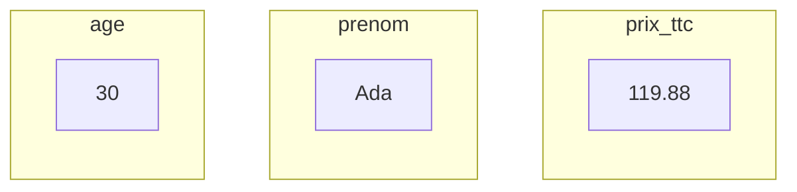
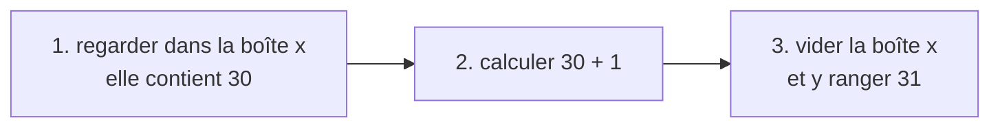
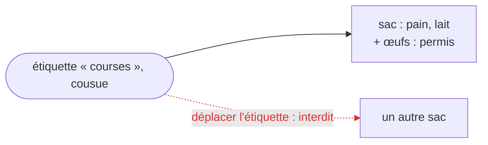
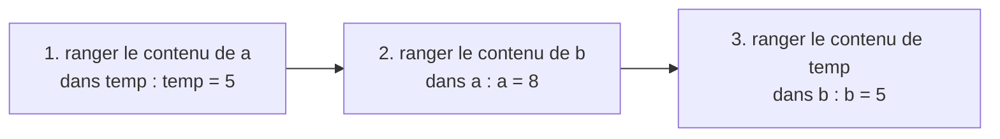

[Sommaire](Readme.md) · [Chapitre suivant →](02-Types.md)

# Variables et constantes

## 🎯 Objectifs

À la fin de ce chapitre, vous saurez :

1. Expliquer ce qu'est une variable et ce que fait une affectation, sans écrire une ligne de code.
2. Distinguer une variable d'une constante, et savoir ce qu'une constante protège vraiment.
3. Déclarer des variables et des constantes en Python, JavaScript et Java.
4. Nommer correctement vos variables selon les conventions de chaque langage.

---

## 1. L'idée : des boîtes étiquetées

Un programme manipule des **valeurs** : un âge, un prix, un prénom. Pour s'en resservir, il faut les ranger quelque part, et pouvoir les retrouver.

Imaginez des **boîtes**. Sur chaque boîte, une **étiquette** porte un nom ; dans la boîte, on range une valeur. En programmation, cette boîte s'appelle une **variable** : l'étiquette est son **nom**, le contenu est sa **valeur**.



### Quatre gestes

Tout ce qu'on fait avec une variable se ramène à quatre gestes :

| Geste avec la boîte | Nom en programmation |
|---|---|
| prendre une boîte vide et écrire un nom sur l'étiquette | **déclarer** la variable |
| ranger une valeur dans la boîte | **affecter** une valeur |
| regarder ce qu'il y a dans la boîte | **lire** la variable |
| vider la boîte et y ranger autre chose | **réaffecter** : l'ancien contenu est perdu |

Deux règles, valables dans tous les langages :

- **regarder ne vide pas la boîte** : on peut lire une variable autant de fois qu'on veut, sa valeur reste en place ;
- **une boîte ne contient qu'une valeur à la fois** : en ranger une nouvelle fait disparaître l'ancienne.

### Lire de droite à gauche

« x prend la valeur x + 1 » : en mathématiques, l'instruction serait absurde. Avec les boîtes, elle se comprend en trois temps :



On commence par la droite, le calcul, et on finit par la gauche, la boîte où l'on range le résultat. Le signe `=` des langages de programmation désigne ce rangement, et non l'égalité des mathématiques.

### Les constantes : des boîtes scellées

Certaines valeurs ne doivent jamais changer pendant que le programme tourne : un taux de TVA, le nombre de jours d'une semaine, l'adresse d'un service. On les range dans une boîte que l'on **scelle** : on peut toujours regarder dedans, mais on ne peut plus en changer le contenu. C'est une **constante**.

Selon les langages, le scellé est plus ou moins solide :

| Le scellé ressemble à… | Si l'on tente de changer le contenu | Langage |
|---|---|---|
| un autocollant « Ne pas toucher » | rien ne l'empêche : tout le monde est prévenu, c'est une affaire de discipline | Python |
| une alarme | le programme démarre, puis s'arrête en erreur au moment où l'on touche à la boîte | JavaScript |
| un contrôle à l'entrée | le programme est refusé avant même de démarrer | Java |

### L'étiquette cousue sur un sac

Une boîte contient une valeur simple. Un **sac**, lui, peut contenir plusieurs choses : c'est l'image des listes, qu'on retrouvera au chapitre 03.

Cousez l'étiquette « courses » sur un sac : vous ne pourrez plus la déplacer sur un autre sac, mais rien ne vous empêche d'ajouter des œufs dans celui-ci. Ce qui est fixé, c'est **le lien entre l'étiquette et le sac**, pas **le contenu du sac**.



À retenir : **constante ne veut pas dire immuable**.

---

## 2. En code : déclarer et affecter

Passons aux langages. Les quatre gestes s'y retrouvent, avec une syntaxe différente.

Python :

```python
age = 30                 # déclaration et affectation en une fois
prenom = "Ada"
age = age + 1            # réaffectation : age vaut maintenant 31
print(prenom, age)       # Ada 31
```

JavaScript :

```javascript
let age = 30;            // let : variable que l'on pourra réaffecter
let prenom = "Ada";
age = age + 1;
console.log(prenom, age); // Ada 31
```

Java :

```java
void main() {
    int age = 30;            // le type est écrit avant le nom
    String prenom = "Ada";
    var annee = 2026;        // var : le compilateur déduit le type (int)
    age = age + 1;
    IO.println(prenom + " " + age + " " + annee); // Ada 31 2026
}
```

> Les exemples Java de ce cours utilisent les **fichiers source compacts** de Java 25 : un fichier contenant `void main() { … }` se lance directement avec `java Fichier.java`, sans classe à écrire autour.

Une différence de fond apparaît déjà : en Python, on affecte sans rien déclarer ; en JavaScript, on déclare avec `let` ; en Java, on déclare avec un **type**, et la boîte ne pourra jamais contenir autre chose qu'une valeur de ce type (voir le chapitre suivant).

> En JavaScript, vous croiserez aussi `var` dans du code ancien. Sa portée est plus large et source de bugs : utilisez toujours `let` ou `const`.

---

## 3. Les constantes en code

Les trois scellés de la section 1, autocollant, alarme et contrôle à l'entrée, s'écrivent ainsi :

| Langage | Syntaxe | Ce qui est garanti |
|---|---|---|
| Python | `TAUX_TVA = 0.20` | rien : c'est une **convention** (nom en majuscules) ; un vérificateur de types signale la réaffectation si l'on écrit `TAUX_TVA: Final = 0.20` |
| JavaScript | `const TAUX_TVA = 0.20;` | le nom ne peut pas être réaffecté : erreur à l'exécution |
| Java | `final double TAUX_TVA = 0.20;` | le nom ne peut pas être réaffecté : erreur **à la compilation** |

```python
from typing import Final

TAUX_TVA: Final = 0.20
prix_ht = 99.90
print(round(prix_ht * (1 + TAUX_TVA), 2))   # 119.88
```

```javascript
const TAUX_TVA = 0.20;
const prixHt = 99.90;
console.log((prixHt * (1 + TAUX_TVA)).toFixed(2)); // 119.88
```

```java
final double TAUX_TVA = 0.20;   // champ constant du fichier

void main() {
    double prixHt = 99.90;
    IO.println(Math.round(prixHt * (1 + TAUX_TVA) * 100) / 100.0); // 119.88
}
```

L'étiquette cousue sur le sac, maintenant : `const` (JavaScript) et `final` (Java) empêchent de faire pointer le nom vers un **autre** sac, pas d'en **modifier** le contenu.

```javascript
const courses = ["pain", "lait"];
courses.push("œufs");             // permis : on ajoute dans le sac
console.log(courses);             // [ 'pain', 'lait', 'œufs' ]
// courses = ["riz"];             ← interdit : TypeError: Assignment to constant variable.
```

```java
void main() {
    final List<String> courses = new ArrayList<>(List.of("pain", "lait"));
    courses.add("œufs");              // permis
    IO.println(courses);              // [pain, lait, œufs]
    // courses = new ArrayList<>();   ← refusé à la compilation
}
```

On y revient au chapitre 03, avec les listes.

**Règle pratique :** déclarez par défaut avec `const` (JavaScript) ou `final` (Java), et ne passez à `let` ou à une variable ordinaire que si la valeur doit réellement changer. Le code est plus facile à lire quand on sait d'emblée ce qui ne bouge pas.

---

## 4. Bien nommer

Dans un déménagement, une boîte marquée « divers » oblige à l'ouvrir pour savoir ce qu'elle contient ; une boîte marquée « vaisselle fragile » se comprend seule. Il en va de même pour les variables : `nb_tentatives` se comprend seul, `n` ou `x2` obligent à relire le code pour deviner. Un nom clair vaut mieux qu'un commentaire.

| Convention | Forme | Utilisée pour |
|---|---|---|
| *snake_case* | `prix_ttc` | variables et fonctions en Python |
| *camelCase* | `prixTtc` | variables et fonctions en JavaScript et Java |
| *UPPER_SNAKE_CASE* | `TAUX_TVA` | constantes, dans les trois langages |
| *PascalCase* | `CompteBancaire` | classes, dans les trois langages (chapitre 05) |

Quelques règles communes :

- un nom commence par une lettre (ou `_`), jamais par un chiffre ;
- les mots réservés du langage (`class`, `for`, `if`, `return`…) sont interdits ;
- la **casse compte** : `age` et `Age` sont deux variables différentes ;
- évitez les accents dans les noms, même quand le langage les accepte.

---

## 5. Exercice

1. Déclarez deux variables `a = 5` et `b = 8`, puis **échangez** leurs valeurs, de sorte que `a` vaille 8 et `b` vaille 5. *Indice : pour échanger le contenu de deux verres, il faut un troisième verre.*
2. Déclarez une constante `REMISE` valant 0.15 et une variable `prix` valant 40. Calculez et affichez le prix remisé.
3. Essayez de réaffecter la constante. Que se passe-t-il dans chacun des trois langages ?

Faites l'exercice dans le langage de votre choix, puis comparez avec la correction.

<details>
<summary>Voir la correction</summary>

L'échange passe par une troisième boîte, temporaire :



```python
a = 5
b = 8
temp = a
a = b
b = temp
print(a, b)          # 8 5

a, b = b, a          # Python sait aussi échanger en une ligne
print(a, b)          # 5 8

REMISE = 0.15
prix = 40
print(prix * (1 - REMISE))   # 34.0
```

```javascript
let a = 5;
let b = 8;
[a, b] = [b, a];             // affectation par décomposition
console.log(a, b);           // 8 5

const REMISE = 0.15;
const prix = 40;
console.log(prix * (1 - REMISE)); // 34
```

```java
void main() {
    int a = 5;
    int b = 8;
    int temp = a;
    a = b;
    b = temp;
    IO.println(a + " " + b);   // 8 5

    final double REMISE = 0.15;
    int prix = 40;
    IO.println(prix * (1 - REMISE)); // 34.0
}
```

Réaffecter la constante :

- **Python** l'accepte sans broncher : l'autocollant n'est qu'une convention. Seul un vérificateur de types (mypy, Pyright) signale l'erreur, et seulement si la constante est annotée `Final`.
- **JavaScript** déclenche l'alarme à l'exécution : `TypeError: Assignment to constant variable.`
- **Java** refuse de compiler : `cannot assign a value to final variable REMISE`.

</details>

---

[Sommaire](Readme.md) · [Chapitre suivant →](02-Types.md)
