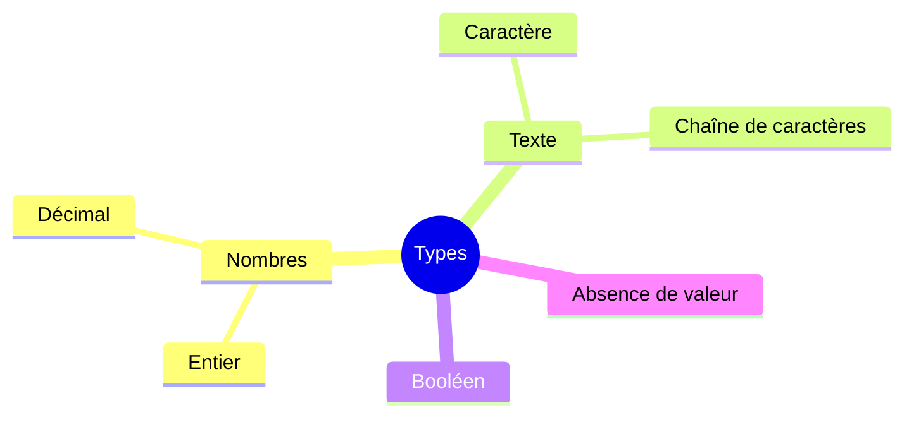
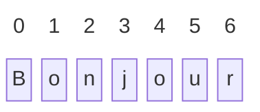
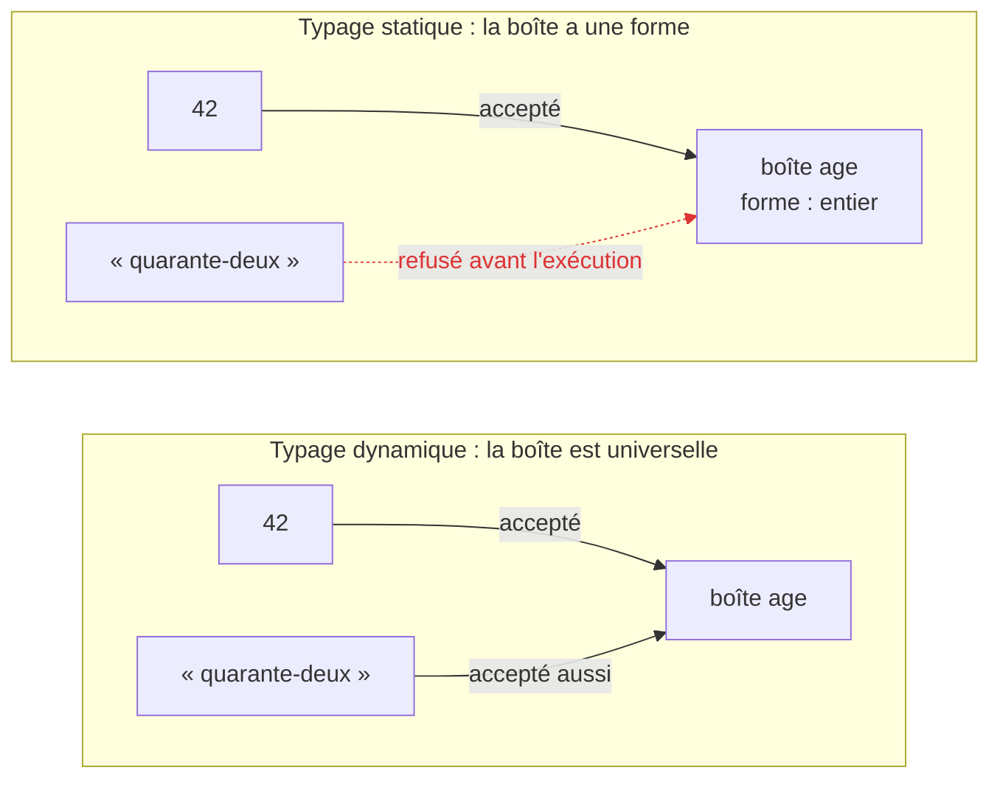
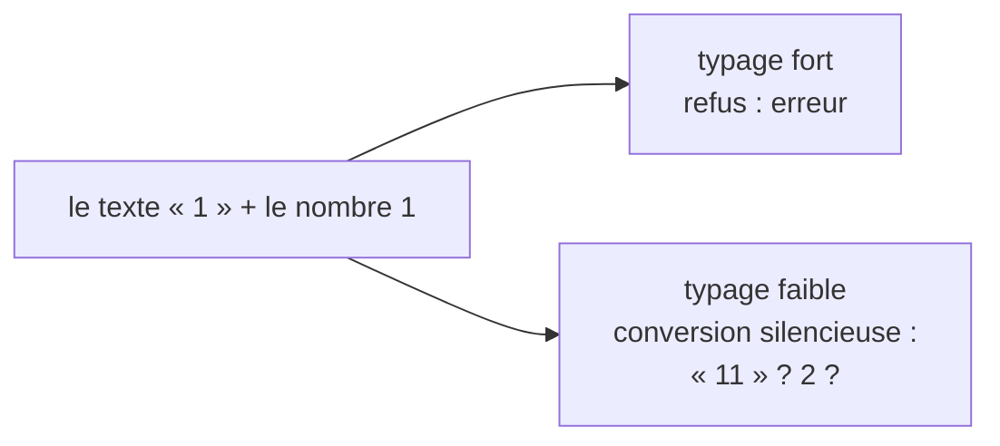
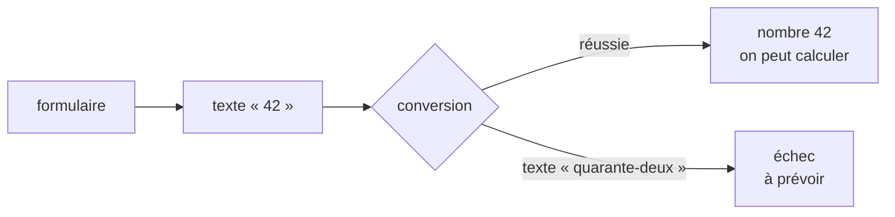

[← Chapitre précédent](01-Variables-et-constantes.md) · [Sommaire](Readme.md) · [Chapitre suivant →](03-Tableaux-et-listes.md)

# Types

## 🎯 Objectifs

À la fin de ce chapitre, vous saurez :

1. Expliquer ce qu'est un type, et nommer les types de base qu'on retrouve dans tous les langages.
2. Manipuler une chaîne de caractères comme une suite de caractères : longueur, position, morceau, parcours.
3. Distinguer typage statique et dynamique, typage fort et faible.
4. Convertir une valeur d'un type à un autre, et éviter les pièges classiques.

---

## 1. L'idée : chaque valeur a une nature

Dans les boîtes du chapitre précédent, on range un âge, un prénom, un prix, une réponse par oui ou par non. Ces valeurs ne sont pas de même **nature**, et on ne s'en sert pas de la même façon : on additionne deux âges, on met un prénom en majuscules ; mais on ne met pas un âge en majuscules, et multiplier deux prénoms n'a aucun sens.

Le **type** d'une valeur, c'est sa nature : il dit ce qu'elle représente, et quelles opérations ont un sens sur elle. Pour la machine, tout n'est que suite de 0 et de 1 ; c'est le type qui dit comment les interpréter.

Les mêmes grandes familles existent dans tous les langages :



| Famille | Ce qu'elle représente | Exemples | Ce qu'on en fait |
|---|---|---|---|
| Entier | une quantité qui se compte | 42, –7 | calculer, comparer |
| Décimal (« flottant ») | une mesure | 3,14 ; 1,75 | calculer, arrondir |
| Booléen | une réponse par oui ou par non | vrai, faux | combiner : et, ou, non |
| Caractère | un seul signe | B, é, ? | le comparer, le combiner en texte |
| Chaîne de caractères | un texte | Bonjour | mettre bout à bout, découper, chercher dedans |
| Absence de valeur | « rien » : une boîte vide | — | tester si c'est vide |

---

## 2. L'idée : un texte est une suite de caractères

Le mot « chaîne » n'est pas choisi au hasard. Une **chaîne de caractères** est une suite de caractères enfilés les uns derrière les autres, comme des perles sur un fil, ou les lettres posées sur un chevalet de Scrabble. Chaque caractère occupe une **position**, numérotée à partir de **0** :



Une chaîne se comporte donc comme une **liste de caractères** (les listes sont le sujet du chapitre 03). On peut :

- connaître sa **longueur** : « Bonjour » compte 7 caractères ;
- lire le caractère situé à une **position** : en 0, « B » ; en 3, « j » ;
- en extraire un **morceau** : des positions 0 à 2, « Bon » ;
- la **parcourir** caractère par caractère, par exemple pour compter les voyelles.

Deux précisions :

- **les perles sont collées** : dans la plupart des langages, on ne peut pas remplacer un caractère au milieu d'une chaîne. Pour « changer » une lettre, on fabrique une nouvelle chaîne. On dit que les chaînes sont **immuables** ;
- **un caractère est un nombre déguisé** : chaque caractère porte un numéro dans une grande table universelle, **Unicode**. « A » porte le numéro 65, « a » le 97, « é » le 233. C'est ainsi que la machine stocke du texte avec des 0 et des 1.

---

## 3. L'idée : boîtes à forme ou boîte universelle ?

Reprenons les boîtes du chapitre 01. Deux philosophies s'opposent.

- Dans certains langages, chaque boîte a une **forme** : une boîte à œufs ne reçoit que des œufs. On choisit le type de la boîte en la créant, et toute tentative d'y ranger autre chose est refusée **avant même de lancer le programme**. C'est le typage **statique**.
- Dans d'autres, les boîtes sont **universelles** : c'est la valeur qui a un type, pas la boîte. Une même boîte peut contenir un nombre, puis un texte. C'est le typage **dynamique**.



Une seconde question, indépendante de la première : que fait le langage quand on **mélange** deux natures, par exemple quand on demande d'additionner le texte « 1 » et le nombre 1 ?

- un langage à typage **fort** refuse, et demande de préciser ce qu'on veut ;
- un langage à typage **faible** convertit l'une des deux valeurs en silence, comme un employé trop zélé qui devine ce que vous vouliez dire, parfois de travers.



Enfin, les données venues de l'extérieur, saisie au clavier, fichier, formulaire web, arrivent presque toujours sous forme de **texte** : le « 42 » tapé dans un formulaire est une chaîne de deux caractères, « 4 » et « 2 », pas un nombre. Avant de calculer, il faut le **convertir**, et prévoir le cas où la conversion est impossible.



---

## 4. Les types en code

Les familles de la section 1, dans les trois langages :

| Famille | Python | JavaScript | Java |
|---|---|---|---|
| Entier | `int` | `number` (ou `bigint`) | `int`, `long` |
| Décimal | `float` | `number` | `double` |
| Booléen | `bool` : `True`, `False` | `boolean` : `true`, `false` | `boolean` : `true`, `false` |
| Caractère | pas de type dédié : une chaîne de longueur 1 | pas de type dédié : une chaîne de longueur 1 | `char` : `'B'` |
| Chaîne de caractères | `str` : `"Bonjour"` | `string` : `"Bonjour"` | `String` : `"Bonjour"` |
| Absence de valeur | `None` | `null`, `undefined` | `null` |

Quelques particularités à connaître :

- **Python** : les entiers n'ont pas de limite de taille (`2 ** 100` est calculé exactement).
- **JavaScript** : entiers et décimaux partagent le même type `number`, un nombre décimal sur 64 bits ; au-delà de 2⁵³, les entiers perdent en précision, d'où le type `bigint` (`123n`). Il y a deux « absences » : `undefined` (jamais affecté) et `null` (vide volontairement).
- **Java** : `int` va d'environ –2,1 à +2,1 milliards, `long` beaucoup plus loin. Les types en minuscules (`int`, `double`, `boolean`, `char`) sont des **types primitifs** ; `String` est un objet, d'où sa majuscule. Un `char` s'écrit entre apostrophes (`'B'`), une `String` entre guillemets (`"B"`).

Connaître le type d'une valeur :

```python
print(type(42))        # <class 'int'>
print(type(3.14))      # <class 'float'>
print(type("42"))      # <class 'str'>
print(type(True))      # <class 'bool'>
print(type(None))      # <class 'NoneType'>
```

```javascript
console.log(typeof 42);        // number
console.log(typeof 3.14);      // number
console.log(typeof "42");      // string
console.log(typeof true);      // boolean
console.log(typeof undefined); // undefined
console.log(typeof null);      // object  ← erreur historique du langage, jamais corrigée
```

En Java, le type d'une variable est écrit dans le code : on le connaît avant même d'exécuter le programme.

---

## 5. Les chaînes en code

Le chevalet de Scrabble de la section 2, dans les trois langages :

```python
mot = "Bonjour"
print(len(mot))          # 7      la longueur
print(mot[0], mot[3])    # B j    le caractère à une position
print(mot[-1])           # r      le dernier (position négative : en partant de la fin)
print(mot[0:3])          # Bon    un morceau, de la position 0 incluse à 3 exclue
print(list(mot))         # ['B', 'o', 'n', 'j', 'o', 'u', 'r']

voyelles = 0
for lettre in mot:       # parcours, caractère par caractère
    if lettre in "aeiouy":
        voyelles += 1
print(voyelles)          # 3

print(ord("A"), chr(233))   # 65 é    le numéro Unicode d'un caractère, et l'inverse
```

```javascript
const mot = "Bonjour";
console.log(mot.length);            // 7
console.log(mot[0], mot[3]);        // B j
console.log(mot.at(-1));            // r
console.log(mot.slice(0, 3));       // Bon
console.log([...mot].join(" | "));  // B | o | n | j | o | u | r   ([...mot] : la liste des caractères)

let voyelles = 0;
for (const lettre of mot) {
  if ("aeiouy".includes(lettre)) voyelles++;
}
console.log(voyelles);              // 3

console.log("A".codePointAt(0), String.fromCodePoint(233)); // 65 é
```

```java
void main() {
    String mot = "Bonjour";
    IO.println(mot.length());                         // 7
    IO.println(mot.charAt(0) + " " + mot.charAt(3));  // B j
    IO.println(mot.charAt(mot.length() - 1));         // r
    IO.println(mot.substring(0, 3));                  // Bon
    char[] lettres = mot.toCharArray();               // la chaîne devenue tableau de caractères
    IO.println(Arrays.toString(lettres));             // [B, o, n, j, o, u, r]

    int voyelles = 0;
    for (char lettre : lettres) {
        if ("aeiouy".indexOf(lettre) >= 0) voyelles++;
    }
    IO.println(voyelles);                             // 3

    IO.println((int) 'A' + " " + (char) 233);         // 65 é
    IO.println(mot.charAt(0) + mot.charAt(3));        // 172  ← deux char s'additionnent comme des nombres : 66 + 106 !
}
```

La dernière ligne montre qu'en Java, un `char` **est** un nombre : additionner deux caractères additionne leurs numéros Unicode. Pour les mettre bout à bout, il faut passer par une `String`, d'où le `" "` intercalé plus haut.

Les perles sont collées : une chaîne ne se modifie pas sur place, on en fabrique une nouvelle.

```python
mot = "Bonjour"
try:
    mot[0] = "b"
except TypeError as erreur:
    print("TypeError :", erreur)   # TypeError : 'str' object does not support item assignment
mot = "b" + mot[1:]                # une nouvelle chaîne, rangée dans la même boîte
print(mot)                         # bonjour
```

En JavaScript, `mot[0] = "b"` lève une `TypeError` dans un module (fichier `.mjs`), et est **ignoré en silence** dans un simple script : la chaîne reste inchangée. En Java, il n'existe tout simplement pas d'opération pour remplacer un caractère d'une `String`.

| | Python | JavaScript | Java |
|---|---|---|---|
| Longueur | `len(mot)` | `mot.length` | `mot.length()` |
| Caractère en position `i` | `mot[i]` | `mot[i]` | `mot.charAt(i)` |
| Morceau de `i` à `j` (exclu) | `mot[i:j]` | `mot.slice(i, j)` | `mot.substring(i, j)` |
| Liste des caractères | `list(mot)` | `[...mot]` | `mot.toCharArray()` |
| Parcourir | `for c in mot:` | `for (const c of mot)` | `for (char c : mot.toCharArray())` |
| Numéro Unicode | `ord("A")` | `"A".codePointAt(0)` | `(int) 'A'` |

> Certains caractères, dont les emoji, occupent **deux** positions en JavaScript et en Java, qui comptent en unités de 16 bits : `"😀".length` vaut 2 en JavaScript, alors que `len("😀")` vaut 1 en Python. Pour compter les caractères tels qu'on les voit : `[..."😀"].length` en JavaScript, `"😀".codePointCount(0, "😀".length())` en Java.

---

## 6. Statique ou dynamique, fort ou faible : en code

**Boîte à forme ou boîte universelle ?**

| Typage | Principe | Langages |
|---|---|---|
| **Statique** | chaque variable a un type fixé, vérifié **avant l'exécution**, à la compilation | Java, C#, TypeScript, Go, Rust |
| **Dynamique** | ce sont les **valeurs** qui ont un type ; une variable peut recevoir une valeur de n'importe quel type | Python, JavaScript, PHP, Ruby |

```python
x = 42
x = "quarante-deux"    # accepté : x désigne maintenant un texte
print(x)
```

```java
void main() {
    int x = 42;
    // x = "quarante-deux";   ← refusé à la compilation : incompatible types
    IO.println(x);
}
```

Le typage statique détecte une classe entière d'erreurs avant même de lancer le programme, et permet à l'éditeur de proposer l'autocomplétion. Le typage dynamique est plus souple et plus concis. Les deux mondes se rapprochent : Python accepte des **annotations de type** vérifiées par des outils comme mypy ou Pyright, et **TypeScript** ajoute un typage statique à JavaScript.

```python
def prix_ttc(prix_ht: float, taux: float = 0.20) -> float:
    return prix_ht * (1 + taux)

print(prix_ttc(100))   # 120.0
```

> Les annotations Python ne sont **pas** vérifiées à l'exécution : `prix_ttc("100")` plante plus loin, pas à l'appel. C'est l'outil de vérification, lancé à part, qui signale l'erreur.

**Le langage convertit-il dans votre dos ?**

```python
try:
    print("1" + 1)
except TypeError as erreur:
    print("TypeError :", erreur)   # Python refuse : can only concatenate str (not "int") to str
```

```javascript
console.log("1" + 1);    // 11   ← le nombre est converti en texte
console.log("5" - 2);    // 3    ← le texte est converti en nombre
console.log("5" * "2");  // 10
```

```java
void main() {
    IO.println("1" + 1);   // 11 : en Java aussi, + avec une String concatène
    // IO.println("5" - 2);   ← refusé à la compilation
}
```

> En JavaScript, comparez toujours avec `===` (même valeur **et** même type), jamais avec `==`, qui convertit avant de comparer : `"0" == 0` vaut `true`, `"0" === 0` vaut `false`.

---

## 7. Convertir explicitement

Le texte « 42 » venu du formulaire doit être converti avant tout calcul :

```python
age = int("42")
taille = float("1.75")
texte = str(42)
print(age + 1, taille * 2, texte + "!")    # 43 3.5 42!
```

```javascript
const age = Number("42");
const taille = Number("1.75");
const texte = String(42);
console.log(age + 1, taille * 2, texte + "!");  // 43 3.5 42!
console.log(Number("abc"));                     // NaN : « Not a Number »
```

```java
void main() {
    int age = Integer.parseInt("42");
    double taille = Double.parseDouble("1.75");
    String texte = String.valueOf(42);
    IO.println((age + 1) + " " + (taille * 2) + " " + texte + "!"); // 43 3.5 42!
}
```

Une conversion impossible échoue différemment selon le langage : Python lève `ValueError`, Java lève `NumberFormatException`, JavaScript renvoie silencieusement `NaN`, qui se propage ensuite dans tous les calculs.

---

## 8. Deux pièges universels

**La division entière.**

```python
print(7 / 2)    # 3.5
print(7 // 2)   # 3   division entière
print(7 % 2)    # 1   reste (modulo)
```

```javascript
console.log(7 / 2);              // 3.5
console.log(Math.trunc(7 / 2));  // 3
console.log(7 % 2);              // 1
```

```java
void main() {
    IO.println(7 / 2);     // 3    ← deux int : division entière !
    IO.println(7.0 / 2);   // 3.5
    IO.println(7 % 2);     // 1
}
```

**La précision des décimaux.** Les nombres décimaux sont stockés en binaire, et la plupart des fractions décimales (0,1 ; 0,2…) n'y ont pas de représentation exacte :

```python
print(0.1 + 0.2)           # 0.30000000000000004
print(0.1 + 0.2 == 0.3)    # False
```

Le résultat est le même en JavaScript et en Java, car tous trois suivent la même norme (IEEE 754). Conséquences :

- ne comparez jamais deux décimaux avec `==` : vérifiez que leur écart est très petit (`math.isclose` en Python) ;
- pour de l'argent, comptez en **centimes entiers**, ou utilisez un type décimal exact : `decimal.Decimal` en Python, `BigDecimal` en Java.

---

## 9. Exercice

Un formulaire renvoie deux textes : `quantite = "3"` et `prix_unitaire = "19.90"`.

1. Calculez le total à payer. Que donne une addition naïve des deux textes ?
2. Affichez le total arrondi à deux décimales.
3. Que se passe-t-il si `quantite` vaut `"trois"` ?
4. En parcourant `prix_unitaire` caractère par caractère, trouvez la position du point décimal.

<details>
<summary>Voir la correction</summary>

```python
quantite = "3"
prix_unitaire = "19.90"
print(quantite + prix_unitaire)     # 319.90 : deux textes mis bout à bout !

total = int(quantite) * float(prix_unitaire)
print(f"{total:.2f}")               # 59.70

try:
    int("trois")
except ValueError as erreur:
    print("ValueError :", erreur)   # invalid literal for int() with base 10: 'trois'

for position, caractere in enumerate(prix_unitaire):
    if caractere == ".":
        print(position)             # 2
```

```javascript
const quantite = "3";
const prixUnitaire = "19.90";
console.log(quantite + prixUnitaire);           // 319.90

const total = Number(quantite) * Number(prixUnitaire);
console.log(total.toFixed(2));                  // 59.70
console.log(Number("trois") * 19.90);           // NaN : aucune erreur, juste un résultat inutilisable

for (let i = 0; i < prixUnitaire.length; i++) {
  if (prixUnitaire[i] === ".") console.log(i);  // 2
}
```

```java
void main() {
    String quantite = "3";
    String prixUnitaire = "19.90";
    IO.println(quantite + prixUnitaire);        // 319.90

    double total = Integer.parseInt(quantite) * Double.parseDouble(prixUnitaire);
    IO.println(String.format("%.2f", total));   // 59.70 (ou 59,70 selon la langue du système)

    try {
        Integer.parseInt("trois");
    } catch (NumberFormatException erreur) {
        IO.println("NumberFormatException : " + erreur.getMessage()); // For input string: "trois"
    }

    for (int i = 0; i < prixUnitaire.length(); i++) {
        if (prixUnitaire.charAt(i) == '.') IO.println(i);   // 2
    }
}
```

Le piège commun : avant conversion, `+` met les textes bout à bout. Et une saisie invalide doit toujours être prévue, car l'utilisateur finira par la faire. Les trois langages savent aussi chercher directement un caractère : `prix_unitaire.index(".")`, `prixUnitaire.indexOf(".")`, `prixUnitaire.indexOf('.')`.

</details>

---

[← Chapitre précédent](01-Variables-et-constantes.md) · [Sommaire](Readme.md) · [Chapitre suivant →](03-Tableaux-et-listes.md)
