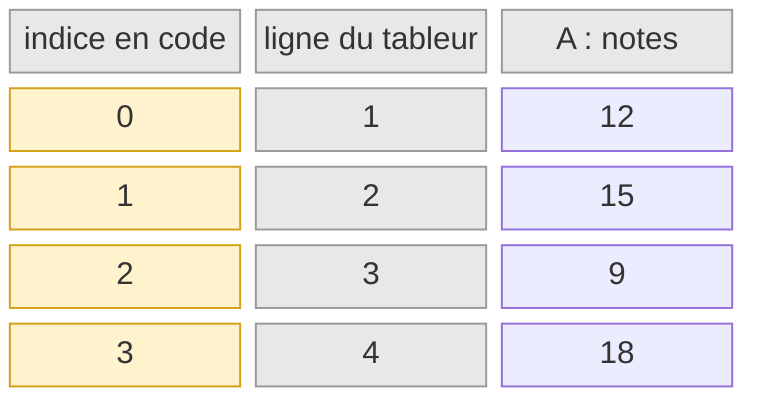
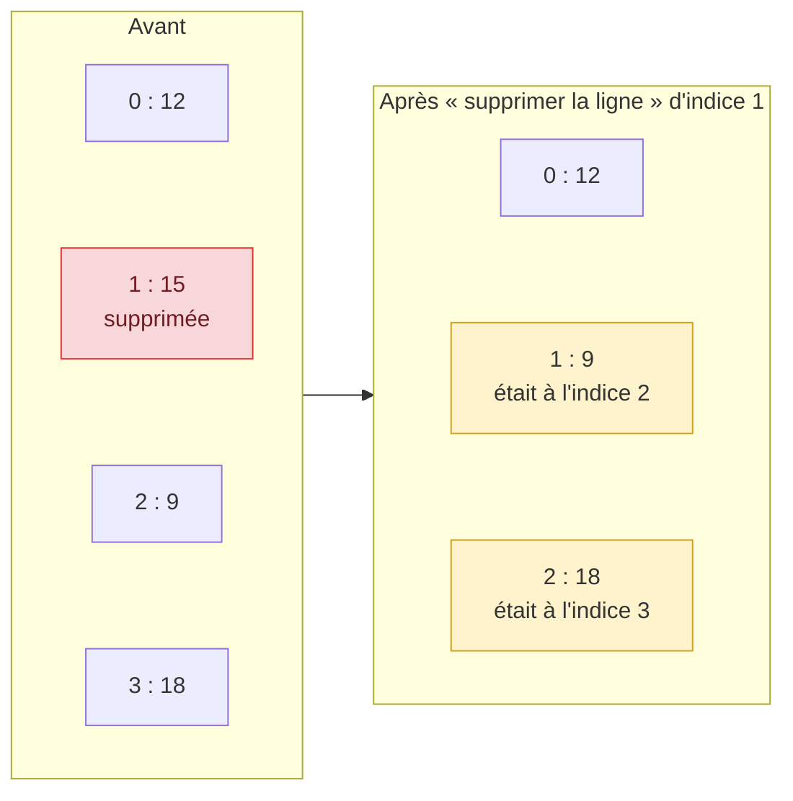
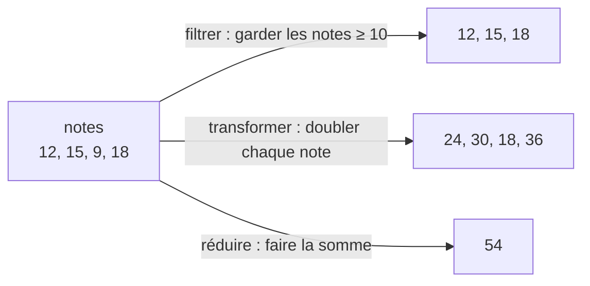
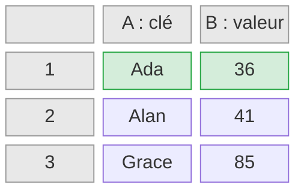
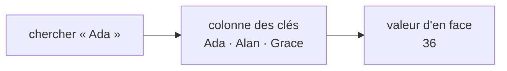
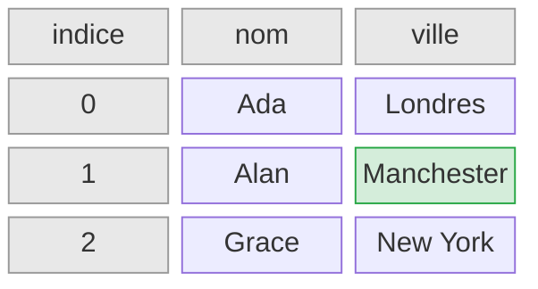
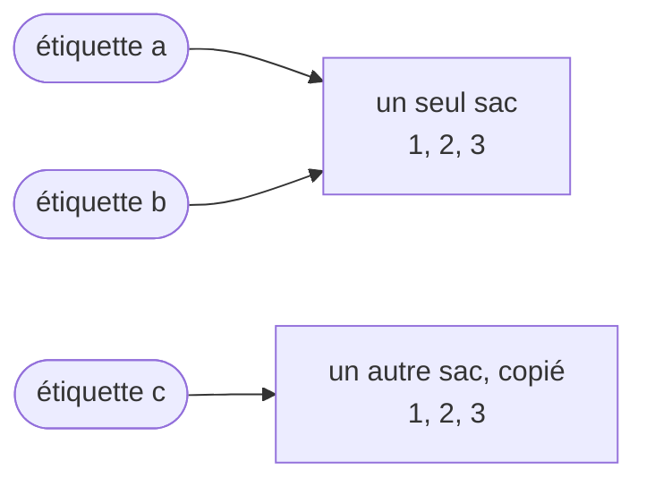

[← Chapitre précédent](02-Types.md) · [Sommaire](Readme.md) · [Chapitre suivant →](04-Objets.md)

# Tableaux et listes

## 🎯 Objectifs

À la fin de ce chapitre, vous saurez :

1. Expliquer ce que sont une liste et un tableau associatif, en les comparant à une feuille de tableur.
2. Distinguer un tableau de taille fixe d'une liste dynamique.
3. Créer une liste, accéder à ses éléments, en ajouter, en retirer, la parcourir et la transformer.
4. Éviter le piège des références partagées.
5. Ranger et retrouver des valeurs par clé dans un tableau associatif.

---

## 1. L'idée : une colonne de tableur

Au chapitre 01, on a rangé plusieurs choses dans un sac. Un sac, c'est pratique, mais c'est du vrac : impossible d'y demander « le troisième article ». Pour ranger des valeurs **dans l'ordre**, et les retrouver par leur **position**, une meilleure image est la **feuille de tableur**, Excel, LibreOffice Calc ou Google Sheets.

Une **liste**, c'est une colonne du tableur. Chaque valeur occupe une cellule, et chaque cellule est repérée par son numéro de ligne :



Une différence, source d'erreurs chez tous les débutants : le tableur numérote ses lignes à partir de **1**, les langages de programmation numérotent leurs positions, appelées **indices**, à partir de **0**. Le premier élément porte l'indice 0, le dernier l'indice **longueur – 1**.

### Les gestes du tableur ont tous un équivalent

| Dans le tableur | Dans une liste |
|---|---|
| lire la cellule A3 | lire l'élément d'indice 2 |
| compter les lignes remplies | connaître la **longueur** de la liste |
| taper une valeur dans la première ligne vide | **ajouter** à la fin |
| clic droit, « Insérer une ligne » | **insérer** à une position |
| clic droit, « Supprimer la ligne » | **retirer** un élément |
| descendre la colonne, cellule par cellule | **parcourir** la liste |
| le filtre automatique | **filtrer** |
| une formule recopiée vers le bas, `=A1*2` | **transformer** chaque élément |
| `=SOMME(A1:A4)`, `=MOYENNE(A1:A4)` | **réduire** la liste à une seule valeur |

Le tableur rend visible un point important : insérer ou supprimer une ligne **décale** toutes celles du dessous. Dans une liste, c'est pareil : après le retrait de l'élément d'indice 1, celui qui avait l'indice 2 passe à l'indice 1.



Filtrer, transformer et réduire produisent un **résultat** à partir de la colonne, sans la modifier :



### Tableau ou liste ?

Dans un tableur, on peut toujours ajouter une ligne. Tous les rangements ne sont pas aussi souples : une boîte à œufs a six alvéoles, ni plus ni moins.

| | Tableau (*array*) | Liste (*list*) |
|---|---|---|
| Image | une boîte à œufs | une colonne de tableur |
| Taille | fixée à la création | change à volonté |
| Ajout, retrait | impossible | oui |
| Exemples | `int[]` en Java | `list` en Python, `Array` en JavaScript, `ArrayList` en Java |

En Python et en JavaScript, la structure de base est déjà une liste dynamique, même si JavaScript l'appelle `Array`. Java distingue les deux : le **tableau** natif, rapide mais de taille fixe, et la **liste** (`List`), dont on se sert le plus souvent.

---

## 2. L'idée : le tableau associatif, deux colonnes

Retrouver une valeur par sa position ne convient pas toujours. Pour connaître l'âge d'Ada, on ne veut pas savoir qu'elle est « à la ligne 3 » : on veut chercher **Ada**.

Dans un tableur, on écrirait deux colonnes : en A, les noms ; en B, les âges. Pour trouver l'âge d'Ada, on cherche « Ada » dans la colonne A, et on lit la cellule d'en face, dans la colonne B. C'est exactement ce que fait la fonction `RECHERCHEV` (ou `RECHERCHEX`).



Un **tableau associatif**, aussi appelé **dictionnaire** ou *map*, range ainsi des **paires clé → valeur** :

- la **clé** joue le rôle de la colonne A : c'est par elle qu'on cherche ;
- la **valeur** est la cellule d'en face, dans la colonne B ;
- chaque clé est **unique** : deux lignes « Ada » rendraient la recherche ambiguë. Ranger une valeur sous une clé qui existe déjà **remplace** l'ancienne ;
- chercher une clé absente échoue, comme `RECHERCHEV` qui répond `#N/A`.



| Dans le tableur | Dans un tableau associatif |
|---|---|
| chercher « Ada » en colonne A, lire la colonne B | lire la valeur de la clé « Ada » |
| ajouter une ligne « Grace / 85 » | ajouter une paire |
| corriger la cellule en face d'« Ada » | modifier la valeur d'une clé |
| supprimer la ligne d'« Alan » | retirer une clé |
| `#N/A` | une erreur, ou une valeur « absente », selon le langage |

### Une feuille avec des en-têtes

Une vraie feuille de tableur combine les deux idées : c'est une **liste** de lignes, et dans chaque ligne, chaque valeur est repérée par le **titre de sa colonne**. Chaque ligne est donc un tableau associatif, dont les clés sont les en-têtes.



La ville d'Alan se trouve à la ligne d'indice 1, dans la colonne « ville ». Cette structure, une liste de fiches, est partout : résultat d'une requête en base de données, contenu d'un fichier CSV, réponse d'un service web au format JSON (chapitre 04).

---

## 3. Créer et lire

Passons au code, en commençant par la colonne de notes.

```python
notes = [12, 15, 9, 18]
print(notes[0])      # 12  premier élément
print(notes[-1])     # 18  dernier élément (indice négatif : en partant de la fin)
print(len(notes))    # 4
print(notes[1:3])    # [15, 9]  une tranche, de l'indice 1 inclus à 3 exclu
```

```javascript
const notes = [12, 15, 9, 18];
console.log(notes[0]);          // 12
console.log(notes.at(-1));      // 18
console.log(notes.length);      // 4
console.log(notes.slice(1, 3)); // [ 15, 9 ]
```

```java
void main() {
    int[] tableau = {12, 15, 9, 18};          // tableau : taille fixe
    IO.println(tableau[0] + " " + tableau.length);   // 12 4

    List<Integer> notes = new ArrayList<>(List.of(12, 15, 9, 18));   // liste modifiable
    IO.println(notes.get(0));                 // 12
    IO.println(notes.getLast());              // 18
    IO.println(notes.size());                 // 4
    IO.println(notes.subList(1, 3));          // [15, 9]
}
```

> Ces exemples Java utilisent `List`, `ArrayList` ou `Map` sans les importer : les fichiers source compacts importent automatiquement les classes de base de Java. Dans un fichier Java classique, il faut écrire `import java.util.List;` en tête (voir le chapitre 07).

> En Java, une liste ne contient que des objets : on écrit `List<Integer>` et non `List<int>`. `Integer` est la version « objet » de `int` ; la conversion entre les deux est automatique.

Ces opérations rappellent celles des chaînes de caractères du chapitre 02 : `notes[0]`, `len(notes)`, `notes[1:3]` s'écrivent exactement comme `mot[0]`, `len(mot)`, `mot[1:3]`. Une chaîne est une liste de caractères.

Que se passe-t-il si l'on demande une ligne qui n'existe pas ?

| Langage | `notes[10]` sur une liste de 4 éléments |
|---|---|
| Python | erreur `IndexError: list index out of range` |
| JavaScript | **aucune erreur** : la valeur `undefined` |
| Java | erreur `IndexOutOfBoundsException`, ou sa variante `ArrayIndexOutOfBoundsException` (tableaux et certaines listes) |

---

## 4. Modifier

Remplacer une cellule, ajouter une ligne en bas, insérer une ligne, supprimer une ligne :

```python
notes = [12, 15, 9, 18]
notes[2] = 10          # remplacer
notes.append(14)       # ajouter à la fin
notes.insert(0, 20)    # insérer à l'indice 0 : tout le reste descend d'un cran
dernier = notes.pop()  # retirer le dernier et le récupérer
notes.remove(15)       # retirer la première occurrence de la valeur 15
print(notes, dernier)  # [20, 12, 10, 18] 14
print(18 in notes)     # True
```

```javascript
const notes = [12, 15, 9, 18];
notes[2] = 10;
notes.push(14);                         // ajouter à la fin
notes.unshift(20);                      // ajouter au début
const dernier = notes.pop();            // retirer le dernier
notes.splice(notes.indexOf(15), 1);     // retirer la valeur 15
console.log(notes, dernier);            // [ 20, 12, 10, 18 ] 14
console.log(notes.includes(18));        // true
```

```java
void main() {
    List<Integer> notes = new ArrayList<>(List.of(12, 15, 9, 18));
    notes.set(2, 10);
    notes.add(14);
    notes.addFirst(20);
    int dernier = notes.removeLast();
    notes.remove(Integer.valueOf(15));    // retirer la VALEUR 15 (et non l'indice 15)
    IO.println(notes + " " + dernier);    // [20, 12, 10, 18] 14
    IO.println(notes.contains(18));       // true
}
```

> Le JavaScript ci-dessus modifie une liste déclarée `const` : c'est l'étiquette cousue sur le sac du chapitre 01. `const` interdit de réaffecter le **nom** `notes`, pas de modifier le **contenu** de la liste.

Les collections **immuables** existent aussi, utiles pour des données qui ne doivent pas changer, comme une plage de cellules verrouillée : le **tuple** en Python (`(12, 15, 9)`), `List.of(…)` en Java (toute modification lève une erreur), `Object.freeze([…])` en JavaScript.

---

## 5. Parcourir et transformer

Descendre la colonne, cellule par cellule, est l'opération la plus courante :

```python
notes = [12, 15, 9, 18]
for note in notes:
    print(note)

for i, note in enumerate(notes):     # avec l'indice
    print(i, note)
```

```javascript
const notes = [12, 15, 9, 18];
for (const note of notes) {
  console.log(note);
}

notes.forEach((note, i) => console.log(i, note));   // avec l'indice
```

```java
void main() {
    List<Integer> notes = List.of(12, 15, 9, 18);
    for (int note : notes) {
        IO.println(note);
    }

    for (int i = 0; i < notes.size(); i++) {   // avec l'indice
        IO.println(i + " " + notes.get(i));
    }
}
```

Le filtre automatique, la formule recopiée vers le bas et la fonction `SOMME` ont leurs équivalents, qui évitent d'écrire la boucle à la main :

```python
notes = [12, 15, 9, 18]
reussites = [n for n in notes if n >= 10]   # filtrer
doubles = [n * 2 for n in notes]            # transformer
print(reussites, doubles, sum(notes))       # [12, 15, 18] [24, 30, 18, 36] 54
```

```javascript
const notes = [12, 15, 9, 18];
const reussites = notes.filter((n) => n >= 10);
const doubles = notes.map((n) => n * 2);
const somme = notes.reduce((total, n) => total + n, 0);
console.log(reussites, doubles, somme);   // [ 12, 15, 18 ] [ 24, 30, 18, 36 ] 54
```

```java
void main() {
    List<Integer> notes = List.of(12, 15, 9, 18);
    List<Integer> reussites = notes.stream().filter(n -> n >= 10).toList();
    List<Integer> doubles = notes.stream().map(n -> n * 2).toList();
    int somme = notes.stream().mapToInt(Integer::intValue).sum();
    IO.println(reussites + " " + doubles + " " + somme);   // [12, 15, 18] [24, 30, 18, 36] 54
}
```

---

## 6. Le piège des références partagées

Reprenons l'image du sac et de son étiquette. Pour une liste, la variable ne contient pas le sac lui-même : c'est une **étiquette accrochée au sac**. Écrire « b prend la valeur de a » ne crée pas un deuxième sac : cela accroche une **deuxième étiquette au même sac**. Tout ce qu'on ajoute par l'étiquette `b` se retrouve donc dans le sac de `a`, puisque c'est le même.



Pour obtenir un sac indépendant, il faut le **copier** explicitement.

```python
a = [1, 2, 3]
b = a            # b désigne la MÊME liste que a
b.append(4)
print(a)         # [1, 2, 3, 4]  ← a a « changé » aussi

c = a.copy()     # une vraie copie
c.append(5)
print(a, c)      # [1, 2, 3, 4] [1, 2, 3, 4, 5]
```

```javascript
const a = [1, 2, 3];
const b = a;
b.push(4);
console.log(a);          // [ 1, 2, 3, 4 ]

const c = [...a];        // copie avec l'opérateur de décomposition
c.push(5);
console.log(a, c);       // [ 1, 2, 3, 4 ] [ 1, 2, 3, 4, 5 ]
```

```java
void main() {
    List<Integer> a = new ArrayList<>(List.of(1, 2, 3));
    List<Integer> b = a;
    b.add(4);
    IO.println(a);               // [1, 2, 3, 4]

    List<Integer> c = new ArrayList<>(a);   // copie
    c.add(5);
    IO.println(a + " " + c);     // [1, 2, 3, 4] [1, 2, 3, 4, 5]
}
```

C'est la même chose quand on passe une liste à une fonction : la fonction reçoit une étiquette vers le même sac, et peut donc le modifier. Le chapitre 04 généralise ce comportement à tous les objets.

> Ces copies sont **superficielles** : si le sac contient lui-même des sacs (des listes ou des objets), ceux-ci restent partagés. Pour tout dupliquer en profondeur : `copy.deepcopy` en Python, `structuredClone` en JavaScript.

---

## 7. Les tableaux associatifs en code

Les deux colonnes de la section 2 : `dict` en Python, `Map` en JavaScript et en Java.

```python
ages = {"Ada": 36, "Alan": 41}       # créer : clé → valeur
ages["Grace"] = 85                   # ajouter une paire
ages["Ada"] = 37                     # la clé existe déjà : la valeur est remplacée
del ages["Alan"]                     # retirer une clé
print(ages["Ada"], len(ages))        # 37 2
print("Alan" in ages)                # False         la clé existe-t-elle ?
print(ages.get("Alan", "inconnu"))   # inconnu       valeur par défaut si la clé manque

for nom, age in ages.items():        # parcourir les paires
    print(nom, age)
# Ada 37
# Grace 85
```

```javascript
const ages = new Map([["Ada", 36], ["Alan", 41]]);
ages.set("Grace", 85);
ages.set("Ada", 37);
ages.delete("Alan");
console.log(ages.get("Ada"), ages.size);     // 37 2
console.log(ages.has("Alan"));               // false
console.log(ages.get("Alan") ?? "inconnu");  // inconnu

for (const [nom, age] of ages) {
  console.log(nom, age);
}
// Ada 37
// Grace 85
```

```java
void main() {
    Map<String, Integer> ages = new LinkedHashMap<>();   // LinkedHashMap : garde l'ordre d'ajout
    ages.put("Ada", 36);
    ages.put("Alan", 41);
    ages.put("Grace", 85);
    ages.put("Ada", 37);
    ages.remove("Alan");
    IO.println(ages.get("Ada") + " " + ages.size());     // 37 2
    IO.println(ages.containsKey("Alan"));                // false
    IO.println(ages.getOrDefault("Alan", -1));           // -1

    for (var paire : ages.entrySet()) {
        IO.println(paire.getKey() + " " + paire.getValue());
    }
    // Ada 37
    // Grace 85
}
```

Le `#N/A` du tableur, c'est-à-dire la lecture d'une clé absente, se traduit différemment :

| Langage | Lire la clé `"Zoé"` absente |
|---|---|
| Python | erreur `KeyError: 'Zoé'` ; `ages.get("Zoé")` renvoie `None` |
| JavaScript | `undefined` |
| Java | `null` |

> Python et JavaScript parcourent les paires dans l'ordre d'ajout. En Java, une `HashMap`, la plus courante, ne garantit **aucun** ordre ; `LinkedHashMap` garde l'ordre d'ajout, `TreeMap` trie les clés.

> En JavaScript, on utilise aussi très souvent un simple objet comme tableau associatif : `const ages = { Ada: 36, Alan: 41 };`, lu avec `ages.Ada` ou `ages["Ada"]`. C'est la forme qu'on retrouve en JSON (chapitre 04).

La feuille avec en-têtes, enfin : une liste de tableaux associatifs.

```python
personnes = [
    {"nom": "Ada", "ville": "Londres"},
    {"nom": "Alan", "ville": "Manchester"},
    {"nom": "Grace", "ville": "New York"},
]
print(personnes[1]["ville"])          # Manchester  ← ligne d'indice 1, colonne « ville »
for p in personnes:
    print(p["nom"], "habite à", p["ville"])
```

```javascript
const personnes = [
  { nom: "Ada", ville: "Londres" },
  { nom: "Alan", ville: "Manchester" },
  { nom: "Grace", ville: "New York" },
];
console.log(personnes[1].ville);      // Manchester
for (const p of personnes) {
  console.log(p.nom, "habite à", p.ville);
}
```

```java
void main() {
    List<Map<String, String>> personnes = List.of(
        Map.of("nom", "Ada", "ville", "Londres"),
        Map.of("nom", "Alan", "ville", "Manchester"),
        Map.of("nom", "Grace", "ville", "New York")
    );
    IO.println(personnes.get(1).get("ville"));   // Manchester
    for (Map<String, String> p : personnes) {
        IO.println(p.get("nom") + " habite à " + p.get("ville"));
    }
}
```

---

## 8. Exercice

À partir de la liste de températures `[14, 17, 21, 19, 12, 23, 18]` :

1. Affichez la première, la dernière et le nombre de mesures.
2. Calculez la température maximale **avec une boucle**, sans fonction toute faite.
3. Calculez la moyenne, puis la liste des températures supérieures à la moyenne.
4. Ajoutez une mesure de 25 degrés, et vérifiez que le maximum a changé.
5. Rangez maintenant les sept premières mesures dans un tableau associatif jour → température (lundi : 14, mardi : 17…). Affichez la température de mercredi, puis, avec une boucle, le jour le plus chaud.

<details>
<summary>Voir la correction</summary>

```python
temperatures = [14, 17, 21, 19, 12, 23, 18]
print(temperatures[0], temperatures[-1], len(temperatures))   # 14 18 7

maximum = temperatures[0]
for t in temperatures:
    if t > maximum:
        maximum = t
print(maximum)                                                # 23

moyenne = sum(temperatures) / len(temperatures)
print(round(moyenne, 1), [t for t in temperatures if t > moyenne])   # 17.7 [21, 19, 23, 18]

temperatures.append(25)
print(max(temperatures))                                      # 25

semaine = {"lundi": 14, "mardi": 17, "mercredi": 21, "jeudi": 19,
           "vendredi": 12, "samedi": 23, "dimanche": 18}
print(semaine["mercredi"])                                    # 21

jour_chaud = "lundi"
for jour, t in semaine.items():
    if t > semaine[jour_chaud]:
        jour_chaud = jour
print(jour_chaud)                                             # samedi
```

```javascript
const temperatures = [14, 17, 21, 19, 12, 23, 18];
console.log(temperatures[0], temperatures.at(-1), temperatures.length); // 14 18 7

let maximum = temperatures[0];
for (const t of temperatures) {
  if (t > maximum) maximum = t;
}
console.log(maximum);                                         // 23

const moyenne = temperatures.reduce((s, t) => s + t, 0) / temperatures.length;
console.log(moyenne.toFixed(1), temperatures.filter((t) => t > moyenne)); // 17.7 [ 21, 19, 23, 18 ]

temperatures.push(25);
console.log(Math.max(...temperatures));                       // 25

const semaine = new Map([
  ["lundi", 14], ["mardi", 17], ["mercredi", 21], ["jeudi", 19],
  ["vendredi", 12], ["samedi", 23], ["dimanche", 18],
]);
console.log(semaine.get("mercredi"));                         // 21

let jourChaud = "lundi";
for (const [jour, t] of semaine) {
  if (t > semaine.get(jourChaud)) jourChaud = jour;
}
console.log(jourChaud);                                       // samedi
```

```java
void main() {
    List<Integer> temperatures = new ArrayList<>(List.of(14, 17, 21, 19, 12, 23, 18));
    IO.println(temperatures.getFirst() + " " + temperatures.getLast() + " " + temperatures.size()); // 14 18 7

    int maximum = temperatures.getFirst();
    for (int t : temperatures) {
        if (t > maximum) maximum = t;
    }
    IO.println(maximum);                                      // 23

    double moyenne = temperatures.stream().mapToInt(Integer::intValue).average().orElse(0);
    IO.println(Math.round(moyenne * 10) / 10.0 + " "
        + temperatures.stream().filter(t -> t > moyenne).toList()); // 17.7 [21, 19, 23, 18]

    temperatures.add(25);
    IO.println(Collections.max(temperatures));                // 25

    Map<String, Integer> semaine = new LinkedHashMap<>();
    String[] jours = {"lundi", "mardi", "mercredi", "jeudi", "vendredi", "samedi", "dimanche"};
    for (int i = 0; i < jours.length; i++) {
        semaine.put(jours[i], temperatures.get(i));
    }
    IO.println(semaine.get("mercredi"));                      // 21

    String jourChaud = "lundi";
    for (var paire : semaine.entrySet()) {
        if (paire.getValue() > semaine.get(jourChaud)) jourChaud = paire.getKey();
    }
    IO.println(jourChaud);                                    // samedi
}
```

</details>

---

[← Chapitre précédent](02-Types.md) · [Sommaire](Readme.md) · [Chapitre suivant →](04-Objets.md)
