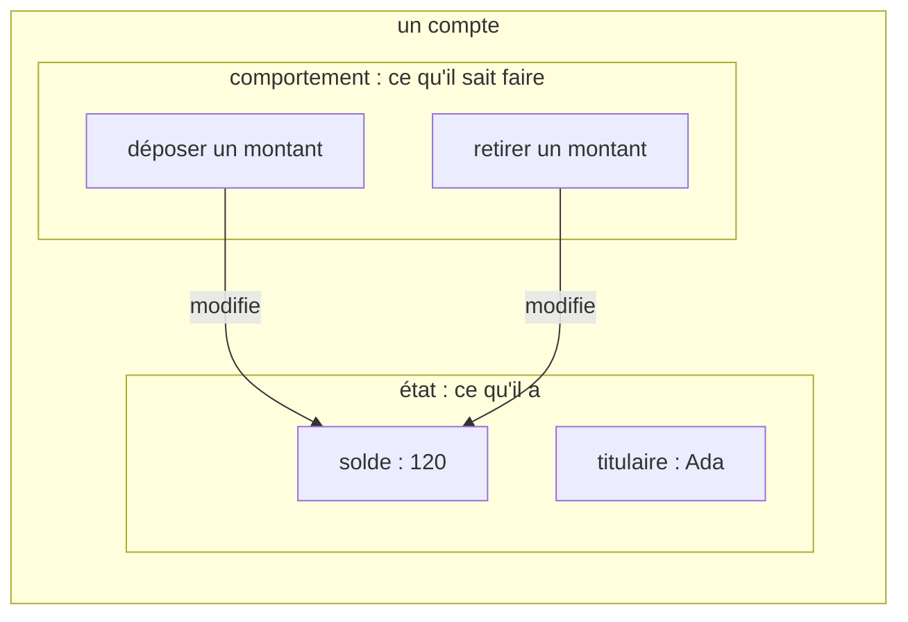
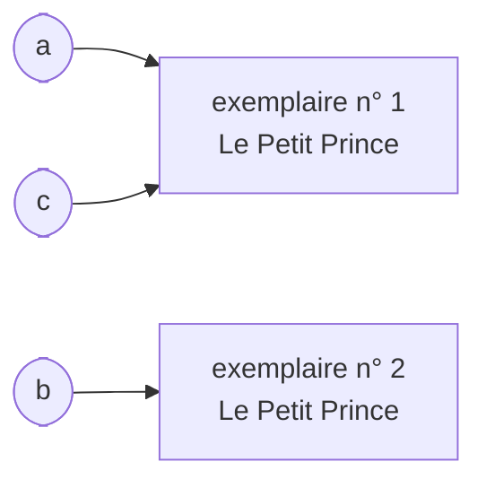
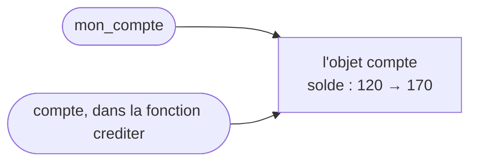
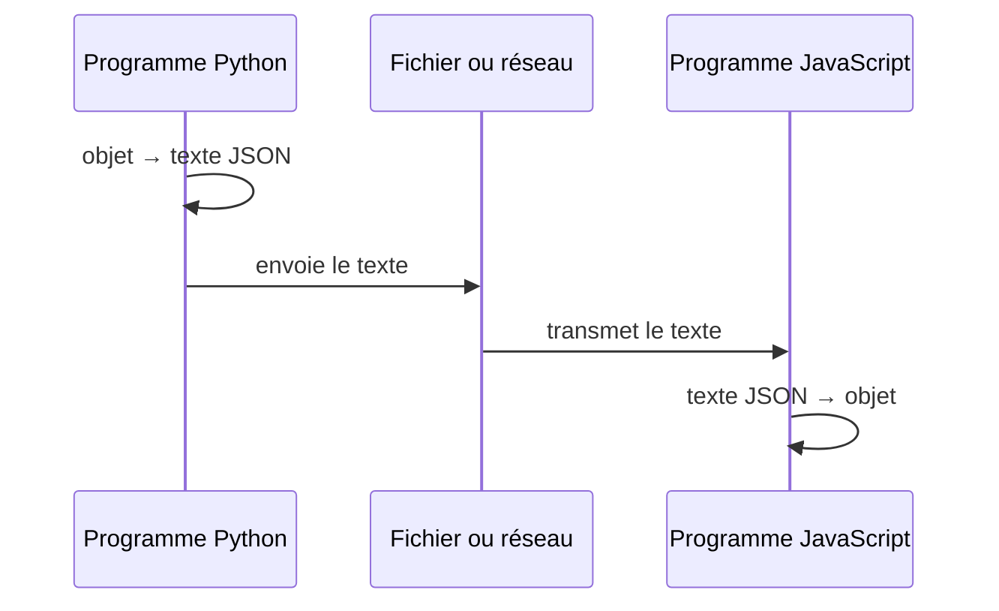

[← Chapitre précédent](03-Tableaux-et-listes.md) · [Sommaire](Readme.md) · [Chapitre suivant →](05-Classes.md)

# Objets

## 🎯 Objectifs

À la fin de ce chapitre, vous saurez :

1. Expliquer ce qu'est un objet : un état et un comportement.
2. Utiliser les propriétés et méthodes d'objets existants.
3. Créer des objets simples et les représenter en JSON.
4. Distinguer l'égalité de deux objets et leur identité.

---

## 1. L'idée : un compte en banque

Pensez à votre compte en banque. Il **a** des caractéristiques : un titulaire, un solde, un historique d'opérations. Et il **sait faire** des choses : recevoir un dépôt, accepter ou refuser un retrait.

Surtout, vous n'écrivez jamais vous-même le nouveau solde sur le relevé. Vous **demandez** un dépôt, et c'est le compte qui met son solde à jour. Ce qu'il sait faire modifie ce qu'il a.

Un **objet**, en programmation, c'est exactement cela. Il regroupe, sous un seul nom :

- des **données**, appelées attributs ou propriétés : son **état**, ce qu'il a ;
- des **actions**, appelées **méthodes** : son **comportement**, ce qu'il sait faire.



Au chapitre 03, une ligne de tableur décrivait déjà une chose, avec ses colonnes : titulaire, solde. Mais une ligne de tableur ne **fait** rien. Un objet, c'est cette ligne, **plus** les actions qui s'y appliquent.

C'est le cœur de la **programmation orientée objet** : plutôt que de faire circuler séparément un nom de titulaire, un solde et des fonctions qui les modifient, on découpe le programme en objets qui collaborent, chacun responsable de ses propres données.

---

## 2. La notation pointée

En français, on dit « le solde **du** compte ». La plupart des langages écrivent la même chose à l'envers, avec un point :

| En français | En code |
|---|---|
| le solde du compte | `compte.solde` |
| compte, dépose 30 € | `compte.deposer(30)` |

Les parenthèses distinguent l'action de la donnée : `compte.solde` **lit** une donnée, `compte.deposer(30)` **déclenche** une action, à laquelle on transmet ce dont elle a besoin, ici le montant.

---

## 3. Vous utilisez déjà des objets

Dans les trois langages, textes et listes sont des objets. La chaîne « ada lovelace » a un état, ses caractères (chapitre 02), et un comportement : se mettre en majuscules, se découper, dire si elle commence par tel mot.

```python
nom = "ada lovelace"
print(nom.upper())                # ADA LOVELACE
print(nom.title())                # Ada Lovelace
print(nom.split(" "))             # ['ada', 'lovelace']
print(nom.startswith("ada"))      # True
```

```javascript
const nom = "ada lovelace";
console.log(nom.toUpperCase());       // ADA LOVELACE
console.log(nom.split(" "));          // [ 'ada', 'lovelace' ]
console.log(nom.startsWith("ada"));   // true
console.log(nom.length);              // 12  ← une propriété : pas de parenthèses
```

```java
void main() {
    String nom = "ada lovelace";
    IO.println(nom.toUpperCase());              // ADA LOVELACE
    IO.println(Arrays.toString(nom.split(" ")));  // [ada, lovelace]
    IO.println(nom.startsWith("ada"));          // true
    IO.println(nom.length());                   // 12
}
```

> Les textes sont **immuables** dans les trois langages : `nom.upper()` ne modifie pas `nom`, il **renvoie un nouveau texte**. Pour garder le résultat, il faut l'affecter : `nom = nom.upper()`.

---

## 4. Créer ses propres objets

Les langages diffèrent ici nettement.

**JavaScript** permet d'écrire un objet directement, sous forme de **littéral** :

```javascript
const compte = {
  titulaire: "Ada",
  solde: 120,
  deposer(montant) {
    this.solde += montant;      // this : l'objet sur lequel la méthode est appelée
  },
};

compte.deposer(30);
compte.devise = "EUR";          // on peut ajouter une propriété à tout moment
console.log(compte.titulaire, compte.solde, compte.devise);   // Ada 150 EUR
```

**Python** n'a pas de littéral d'objet avec méthodes. Pour regrouper des **données**, on utilise un dictionnaire, accessible par clé (chapitre 03) ; pour leur associer des **méthodes**, on écrit une classe (chapitre 05).

```python
compte = {"titulaire": "Ada", "solde": 120}
compte["solde"] += 30
compte["devise"] = "EUR"
print(compte["titulaire"], compte["solde"], compte["devise"])   # Ada 150 EUR
```

**Java** ne crée d'objets qu'à partir d'une **classe** : on décrit d'abord le modèle, puis on fabrique des objets avec `new`. Pour un simple regroupement de données, un **record** déclare la classe en une ligne :

```java
record Point(int x, int y) {}

void main() {
    Point p = new Point(3, 4);
    IO.println(p.x() + " " + p.y());   // 3 4
    IO.println(p);                     // Point[x=3, y=4]
}
```

Le chapitre suivant montre comment écrire des classes complètes, avec leurs méthodes, dans les trois langages.

---

## 5. Égalité et identité

Prenez deux exemplaires du *Petit Prince*, sortis de la même imprimerie. Ils ont **le même contenu**, mot pour mot : ils sont **égaux**. Mais ce sont **deux objets distincts** : si vous annotez le vôtre, le mien ne change pas.

Si je vous prête mon exemplaire, en revanche, nous parlons du **même** livre : vos annotations, je les retrouverai. Les deux noms désignent un seul objet : ils sont **identiques**.



`a` et `b` sont égaux mais distincts ; `a` et `c` sont un seul et même objet. Chaque langage a deux façons de comparer :

| Question | Python | JavaScript | Java |
|---|---|---|---|
| Même contenu ? (égalité) | `a == b` | à écrire soi-même (pas d'opérateur) | `a.equals(b)` |
| Même objet ? (identité) | `a is b` | `a === b` | `a == b` |

```python
a = {"titre": "Le Petit Prince"}
b = {"titre": "Le Petit Prince"}
print(a == b, a is b)    # True False  même contenu, objets distincts
c = a
print(a is c)            # True        deux noms pour le même objet
```

```javascript
const a = { titre: "Le Petit Prince" };
const b = { titre: "Le Petit Prince" };
console.log(a === b);    // false : deux objets distincts, même si le contenu est identique
const c = a;
console.log(a === c);    // true
```

```java
void main() {
    String a = new String("Le Petit Prince");
    String b = new String("Le Petit Prince");
    IO.println(a == b);        // false : deux objets distincts
    IO.println(a.equals(b));   // true  : même contenu
}
```

> **Le piège Java.** Comparer deux textes avec `==` compare leurs **adresses**, pas leur contenu. Cela semble parfois fonctionner (Java réutilise les textes écrits littéralement dans le code), puis échoue sur un texte lu dans un fichier ou saisi par l'utilisateur. Comparez toujours les textes avec `.equals()`.

---

## 6. Les objets se partagent

Prêter un livre, ce n'est pas en donner une photocopie : si l'emprunteur l'annote, vous retrouverez les annotations. C'est l'image des sacs et des étiquettes du chapitre 03, généralisée à tous les objets : une variable ne contient pas l'objet, mais une **référence** vers lui. Affecter un objet à une autre variable, ou le passer à une fonction, ne le copie pas.



```python
def crediter(compte, montant):
    compte["solde"] += montant      # modifie l'objet reçu, pas une copie

mon_compte = {"titulaire": "Ada", "solde": 120}
crediter(mon_compte, 50)
print(mon_compte["solde"])          # 170
```

```javascript
function crediter(compte, montant) {
  compte.solde += montant;
}

const monCompte = { titulaire: "Ada", solde: 120 };
crediter(monCompte, 50);
console.log(monCompte.solde);       // 170
```

C'est pratique, et c'est aussi la source de bugs où un objet « change tout seul » : quelque part, une autre partie du programme le modifie.

---

## 7. JSON : des objets en texte

Votre banque vous envoie un **relevé de compte**. C'est une photographie de l'état du compte, à un instant donné, sur papier : on peut l'envoyer par courrier, le ranger, le lire sans logiciel particulier. Mais on ne fait pas de virement avec un relevé : il reproduit les **données**, pas le **comportement**.

Pour enregistrer un objet dans un fichier, ou l'envoyer sur le réseau, on fait de même : on le convertit en texte. Le format le plus répandu est **JSON** (*JavaScript Object Notation*), lisible par tous les langages. C'est ce qui permet à un programme Python de dialoguer avec un programme JavaScript :



Un texte JSON ressemble à ceci :

```json
{
  "titulaire": "Ada",
  "solde": 120,
  "actif": true,
  "operations": [30, -15]
}
```

```python
import json

compte = {"titulaire": "Ada", "solde": 120, "actif": True, "operations": [30, -15]}
texte = json.dumps(compte)          # objet → texte
print(texte)                        # {"titulaire": "Ada", "solde": 120, "actif": true, "operations": [30, -15]}
relu = json.loads(texte)            # texte → objet
print(relu["operations"][0])        # 30
```

```javascript
const compte = { titulaire: "Ada", solde: 120, actif: true, operations: [30, -15] };
const texte = JSON.stringify(compte);
console.log(texte);                 // {"titulaire":"Ada","solde":120,"actif":true,"operations":[30,-15]}
const relu = JSON.parse(texte);
console.log(relu.operations[0]);    // 30
```

En Java, la conversion passe par une librairie (Jackson, Gson…) : on y revient au chapitre 07.

> JSON ne transporte que des **données** : textes, nombres, booléens, `null`, listes et objets. Les méthodes ne s'y écrivent pas : c'est le relevé, pas le compte.

---

## 8. Exercice

1. Créez un objet `livre` avec un titre, un auteur et une année de parution (littéral en JavaScript, dictionnaire en Python, record en Java).
2. Affichez une phrase du type « *Titre*, de *Auteur* (*année*) ».
3. Créez un second livre au contenu identique. Les deux livres sont-ils égaux ? Identiques ?
4. *(Python ou JavaScript)* Convertissez le livre en JSON, puis relisez-le.

<details>
<summary>Voir la correction</summary>

```python
import json

livre = {"titre": "Les Misérables", "auteur": "Victor Hugo", "annee": 1862}
print(f"{livre['titre']}, de {livre['auteur']} ({livre['annee']})")
# Les Misérables, de Victor Hugo (1862)

autre = {"titre": "Les Misérables", "auteur": "Victor Hugo", "annee": 1862}
print(livre == autre, livre is autre)   # True False

texte = json.dumps(livre, ensure_ascii=False)
print(json.loads(texte)["auteur"])      # Victor Hugo
```

```javascript
const livre = { titre: "Les Misérables", auteur: "Victor Hugo", annee: 1862 };
console.log(`${livre.titre}, de ${livre.auteur} (${livre.annee})`);
// Les Misérables, de Victor Hugo (1862)

const autre = { titre: "Les Misérables", auteur: "Victor Hugo", annee: 1862 };
console.log(livre === autre);                                   // false : objets distincts
console.log(JSON.stringify(livre) === JSON.stringify(autre));   // true : même contenu (comparaison simple, sensible à l'ordre des propriétés)

console.log(JSON.parse(JSON.stringify(livre)).auteur);          // Victor Hugo
```

```java
record Livre(String titre, String auteur, int annee) {}

void main() {
    Livre livre = new Livre("Les Misérables", "Victor Hugo", 1862);
    IO.println(livre.titre() + ", de " + livre.auteur() + " (" + livre.annee() + ")");
    // Les Misérables, de Victor Hugo (1862)

    Livre autre = new Livre("Les Misérables", "Victor Hugo", 1862);
    IO.println(livre.equals(autre) + " " + (livre == autre));   // true false
}
```

Un record Java sait comparer son contenu avec `equals()` sans qu'on l'écrive : c'est l'un de ses intérêts.

</details>

---

[← Chapitre précédent](03-Tableaux-et-listes.md) · [Sommaire](Readme.md) · [Chapitre suivant →](05-Classes.md)
