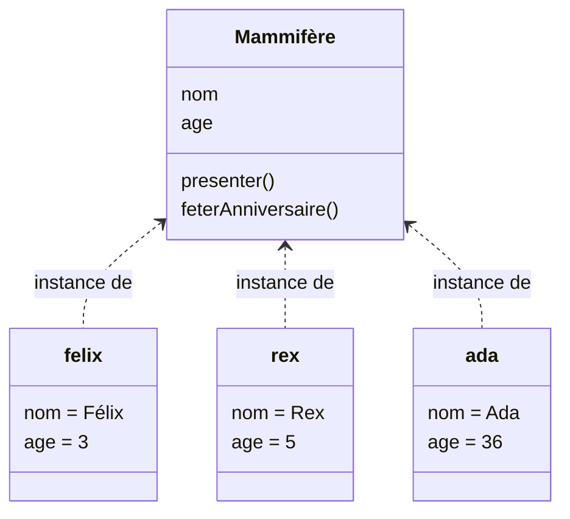
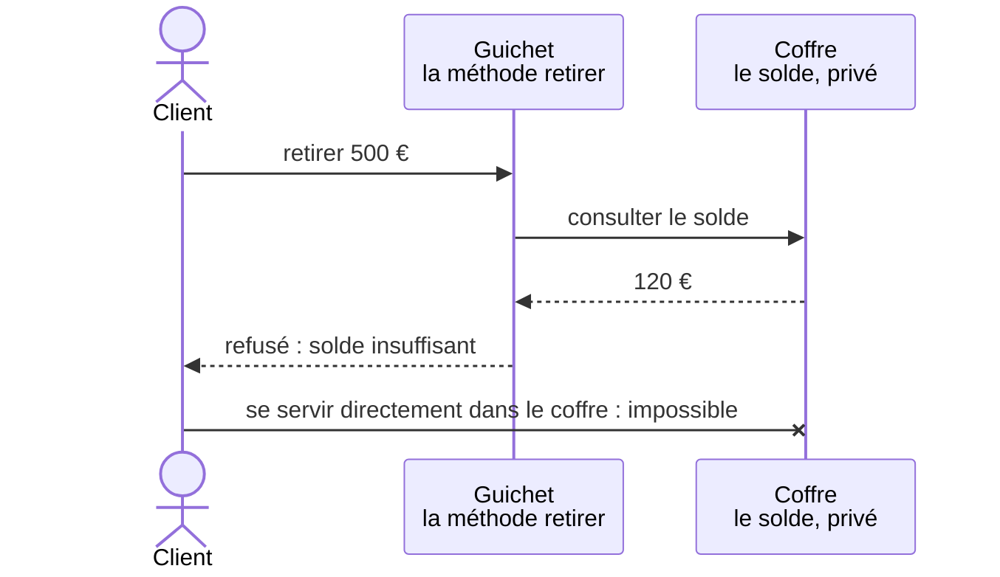
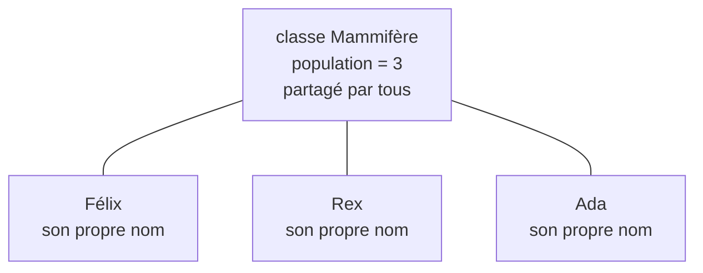

[← Chapitre précédent](04-Objets.md) · [Sommaire](Readme.md) · [Chapitre suivant →](06-Heritage.md)

# Classes

## 🎯 Objectifs

À la fin de ce chapitre, vous saurez :

1. Expliquer la différence entre une classe et une instance, à partir de la classe des mammifères.
2. Écrire une classe avec un constructeur, des attributs et des méthodes.
3. Protéger l'état d'un objet : l'encapsulation.
4. Distinguer membres d'instance et membres de classe.

---

## 1. L'idée : la classe des mammifères

Le mot « classe » vient des sciences naturelles. Les biologistes classent les êtres vivants, et les **mammifères** forment, au sens propre, une **classe** : un ensemble d'animaux qui partagent les mêmes caractéristiques (ils ont des poils, le sang chaud, ils allaitent leurs petits) et les mêmes capacités (respirer, manger, dormir, vieillir).

La classe « Mammifère » ne court pas et ne mange pas : c'est une **description**. Ceux qui courent et qui mangent, ce sont les **individus** : Félix, Rex, Ada. Chacun est un mammifère ; chacun a son propre nom et son propre âge ; tous savent faire les mêmes choses.



En programmation, c'est la même chose. Une **classe** décrit **une fois pour toutes** ce qu'ont et ce que savent faire tous les objets d'une même sorte ; chaque objet fabriqué d'après elle est une **instance** de la classe.

| Dans la nature | En programmation |
|---|---|
| la description commune : « un mammifère a un nom et un âge, il sait se présenter et vieillir » | la **classe** |
| un individu : Félix | une **instance**, c'est-à-dire un objet |
| les caractéristiques de chaque individu : son nom, son âge | les **attributs** |
| ce que chaque individu sait faire | les **méthodes** |
| la naissance, où l'individu reçoit son nom et son âge de départ | le **constructeur** |
| « moi-même » : quand Félix fête son anniversaire, c'est **son** âge qui augmente, pas celui de Rex | **`self`** ou **`this`** |

Certaines informations, enfin, ne concernent aucun individu en particulier, mais la classe tout entière : le nombre de mammifères recensés, par exemple. On les retrouvera à la section 4.

> D'autres images disent la même chose : la classe est le **plan** d'architecte, les instances sont les maisons construites d'après ce plan ; la classe est le **moule**, les instances sont les gâteaux.

---

## 2. Une classe dans les trois langages

La classe des mammifères, écrite trois fois :

```python
class Mammifere:
    def __init__(self, nom, age=0):        # le constructeur : la naissance
        self.nom = nom                     # attributs : propres à chaque individu
        self.age = age

    def presenter(self):
        return f"{self.nom} a {self.age} ans"

    def feter_anniversaire(self):
        self.age += 1                      # self : l'individu qui fête son anniversaire


felix = Mammifere("Félix", 3)              # deux instances de la même classe
rex = Mammifere("Rex", 5)
felix.feter_anniversaire()
print(felix.presenter())                   # Félix a 4 ans
print(rex.presenter())                     # Rex a 5 ans   ← Rex n'a pas vieilli
```

```javascript
class Mammifere {
  constructor(nom, age = 0) {             // le constructeur : la naissance
    this.nom = nom;
    this.age = age;
  }

  presenter() {
    return `${this.nom} a ${this.age} ans`;
  }

  feterAnniversaire() {
    this.age++;
  }
}

const felix = new Mammifere("Félix", 3);
const rex = new Mammifere("Rex", 5);
felix.feterAnniversaire();
console.log(felix.presenter());           // Félix a 4 ans
console.log(rex.presenter());             // Rex a 5 ans
```

```java
class Mammifere {
    String nom;
    int age;

    Mammifere(String nom, int age) {        // le constructeur porte le nom de la classe
        this.nom = nom;
        this.age = age;
    }

    String presenter() {
        return nom + " a " + age + " ans";
    }

    void feterAnniversaire() {
        age++;
    }
}

void main() {
    Mammifere felix = new Mammifere("Félix", 3);
    Mammifere rex = new Mammifere("Rex", 5);
    felix.feterAnniversaire();
    IO.println(felix.presenter());          // Félix a 4 ans
    IO.println(rex.presenter());            // Rex a 5 ans
}
```

Ce qui change d'un langage à l'autre est la syntaxe ; les notions sont les mêmes :

| | Python | JavaScript | Java |
|---|---|---|---|
| Déclarer la classe | `class Mammifere:` | `class Mammifere { … }` | `class Mammifere { … }` |
| Constructeur | `__init__(self, …)` | `constructor(…)` | `Mammifere(…)` |
| Désigner l'instance | `self`, **explicite** en premier paramètre | `this`, implicite | `this`, implicite (souvent omis) |
| Créer une instance | `Mammifere("Félix", 3)` | `new Mammifere("Félix", 3)` | `new Mammifere("Félix", 3)` |
| Appeler une méthode | `felix.presenter()` | `felix.presenter()` | `felix.presenter()` |

> **Conventions de nommage** : les noms de classes s'écrivent en *PascalCase* (`CompteBancaire`) dans les trois langages ; méthodes et attributs suivent la convention des variables (chapitre 01).

---

## 3. L'encapsulation

### L'idée : le guichet de la banque

À la banque, vous ne passez pas derrière le comptoir pour vous servir dans le coffre. Vous vous présentez au **guichet** et vous demandez un retrait ; le guichetier vérifie que votre solde le permet, puis vous remet les billets, ou refuse. Le coffre est **privé** ; le guichet est la seule porte d'entrée, et il applique les règles.



C'est le principe d'**encapsulation** : l'objet protège son état, et ne le laisse modifier qu'au travers de méthodes qui vérifient chaque changement. Si n'importe quelle partie du programme pouvait écrire « solde = –1 000 », les règles du compte ne vaudraient plus rien.

### En code : le compte bancaire

On reprend le compte du chapitre 04, sous forme de classe. Le solde est privé ; `deposer` et `retirer` sont les guichets ; une méthode en lecture seule permet de consulter le solde sans pouvoir le modifier.

```python
class Compte:
    def __init__(self, titulaire, solde=0):
        self.titulaire = titulaire
        self._solde = solde                     # _ : « privé », par convention

    def deposer(self, montant):
        if montant <= 0:
            raise ValueError("Le montant doit être positif")
        self._solde += montant

    def retirer(self, montant):
        if montant > self._solde:
            raise ValueError("Solde insuffisant")
        self._solde -= montant

    @property
    def solde(self):                            # lecture seule de l'extérieur
        return self._solde


compte = Compte("Ada", 120)
compte.deposer(30)
compte.retirer(50)
print(compte.titulaire, compte.solde)           # Ada 100
try:
    compte.retirer(500)
except ValueError as erreur:
    print("Refusé :", erreur)                   # Refusé : Solde insuffisant
```

```javascript
class Compte {
  #solde;                                       // attribut privé

  constructor(titulaire, solde = 0) {
    this.titulaire = titulaire;
    this.#solde = solde;
  }

  deposer(montant) {
    if (montant <= 0) throw new RangeError("Le montant doit être positif");
    this.#solde += montant;
  }

  retirer(montant) {
    if (montant > this.#solde) throw new RangeError("Solde insuffisant");
    this.#solde -= montant;
  }

  get solde() {                                 // lecture seule de l'extérieur
    return this.#solde;
  }
}

const compte = new Compte("Ada", 120);
compte.deposer(30);
compte.retirer(50);
console.log(compte.titulaire, compte.solde);    // Ada 100
try {
  compte.retirer(500);
} catch (erreur) {
  console.log("Refusé :", erreur.message);      // Refusé : Solde insuffisant
}
```

```java
class Compte {
    private final String titulaire;
    private double solde;

    Compte(String titulaire, double solde) {
        this.titulaire = titulaire;
        this.solde = solde;
    }

    void deposer(double montant) {
        if (montant <= 0) throw new IllegalArgumentException("Le montant doit être positif");
        solde += montant;
    }

    void retirer(double montant) {
        if (montant > solde) throw new IllegalArgumentException("Solde insuffisant");
        solde -= montant;
    }

    String getTitulaire() { return titulaire; }
    double getSolde() { return solde; }
}

void main() {
    Compte compte = new Compte("Ada", 120);
    compte.deposer(30);
    compte.retirer(50);
    IO.println(compte.getTitulaire() + " " + compte.getSolde());   // Ada 100.0
    try {
        compte.retirer(500);
    } catch (IllegalArgumentException erreur) {
        IO.println("Refusé : " + erreur.getMessage());             // Refusé : Solde insuffisant
    }
}
```

Le coffre est plus ou moins bien fermé selon le langage :

| | Python | JavaScript | Java |
|---|---|---|---|
| Attribut privé | `_solde` : convention | `#solde` : garanti | `private` : garanti |
| Lecture seule | `@property` | `get solde()` | une méthode `getSolde()` |

- **Java** et **JavaScript** empêchent réellement l'accès au coffre depuis l'extérieur de la classe ;
- **Python** s'en remet à la discipline : un nom commençant par `_` signifie « interne, n'y touchez pas », mais rien ne l'interdit techniquement. C'est l'autocollant « Ne pas toucher » du chapitre 01.

> Dans la classe `Mammifere` de la section 2, l'âge n'est pas protégé : `felix.age = -3` passerait sans erreur. Pour le protéger, la recette est la même : un attribut privé, et `feter_anniversaire()` comme seul guichet.

---

## 4. Membres de classe

Le nombre de mammifères recensés n'appartient ni à Félix, ni à Rex, ni à Ada : il appartient à la **classe** tout entière. Chaque naissance l'augmente, et tout le monde lit la même valeur.



Ces attributs et méthodes qui concernent la classe dans son ensemble s'appellent membres **de classe**, ou **statiques**. Les autres, propres à chaque individu, sont des membres **d'instance**.

```python
class Mammifere:
    population = 0                         # attribut de classe : partagé par tous

    def __init__(self, nom):
        self.nom = nom                     # attribut d'instance : propre à chacun
        Mammifere.population += 1


Mammifere("Félix")
Mammifere("Rex")
Mammifere("Ada")
print(Mammifere.population)                # 3
```

```javascript
class Mammifere {
  static population = 0;

  constructor(nom) {
    this.nom = nom;
    Mammifere.population++;
  }
}

new Mammifere("Félix");
new Mammifere("Rex");
new Mammifere("Ada");
console.log(Mammifere.population);         // 3
```

```java
class Mammifere {
    static int population = 0;
    final String nom;

    Mammifere(String nom) {
        this.nom = nom;
        population++;
    }
}

void main() {
    new Mammifere("Félix");
    new Mammifere("Rex");
    new Mammifere("Ada");
    IO.println(Mammifere.population);      // 3
}
```

---

## 5. Les classes « de données »

Beaucoup de classes ne font que transporter des données, sans règle particulière : un point, une adresse, une ligne de commande. Elles ressemblent à une ligne de tableur (chapitre 03). Les trois langages, ou leurs écosystèmes, proposent des raccourcis qui écrivent pour vous constructeur, affichage et comparaison :

```python
from dataclasses import dataclass

@dataclass(frozen=True)       # frozen : instances immuables
class Point:
    x: int
    y: int

p = Point(3, 4)
print(p, p == Point(3, 4))    # Point(x=3, y=4) True
```

```java
record Point(int x, int y) {}

void main() {
    Point p = new Point(3, 4);
    IO.println(p + " " + p.equals(new Point(3, 4)));   // Point[x=3, y=4] true
}
```

En JavaScript, un littéral d'objet (chapitre 04) joue souvent ce rôle.

---

## 6. Exercice

Écrivez une classe `Rectangle` :

1. construite avec une largeur et une hauteur ;
2. avec une méthode `aire()` et une méthode `perimetre()` ;
3. avec une méthode `est_carre()` (ou `estCarre()`) ;
4. qui refuse, dès la construction, une largeur ou une hauteur négative ou nulle.

Créez un rectangle 3 × 4 et un carré 5 × 5, et affichez leurs caractéristiques.

<details>
<summary>Voir la correction</summary>

```python
class Rectangle:
    def __init__(self, largeur, hauteur):
        if largeur <= 0 or hauteur <= 0:
            raise ValueError("Les dimensions doivent être positives")
        self.largeur = largeur
        self.hauteur = hauteur

    def aire(self):
        return self.largeur * self.hauteur

    def perimetre(self):
        return 2 * (self.largeur + self.hauteur)

    def est_carre(self):
        return self.largeur == self.hauteur


for r in [Rectangle(3, 4), Rectangle(5, 5)]:
    print(r.aire(), r.perimetre(), r.est_carre())
# 12 14 False
# 25 20 True

try:
    Rectangle(-1, 2)
except ValueError as erreur:
    print(erreur)                 # Les dimensions doivent être positives
```

```javascript
class Rectangle {
  constructor(largeur, hauteur) {
    if (largeur <= 0 || hauteur <= 0) {
      throw new RangeError("Les dimensions doivent être positives");
    }
    this.largeur = largeur;
    this.hauteur = hauteur;
  }

  aire() {
    return this.largeur * this.hauteur;
  }

  perimetre() {
    return 2 * (this.largeur + this.hauteur);
  }

  estCarre() {
    return this.largeur === this.hauteur;
  }
}

for (const r of [new Rectangle(3, 4), new Rectangle(5, 5)]) {
  console.log(r.aire(), r.perimetre(), r.estCarre());
}
// 12 14 false
// 25 20 true
```

```java
class Rectangle {
    private final double largeur;
    private final double hauteur;

    Rectangle(double largeur, double hauteur) {
        if (largeur <= 0 || hauteur <= 0) {
            throw new IllegalArgumentException("Les dimensions doivent être positives");
        }
        this.largeur = largeur;
        this.hauteur = hauteur;
    }

    double aire() { return largeur * hauteur; }
    double perimetre() { return 2 * (largeur + hauteur); }
    boolean estCarre() { return largeur == hauteur; }
}

void main() {
    for (Rectangle r : List.of(new Rectangle(3, 4), new Rectangle(5, 5))) {
        IO.println(r.aire() + " " + r.perimetre() + " " + r.estCarre());
    }
    // 12.0 14.0 false
    // 25.0 20.0 true
}
```

Vérifier les dimensions dans le constructeur garantit qu'**aucun** rectangle invalide ne peut exister dans le programme : c'est l'encapsulation appliquée dès la naissance de l'objet.

</details>

---

[← Chapitre précédent](04-Objets.md) · [Sommaire](Readme.md) · [Chapitre suivant →](06-Heritage.md)
