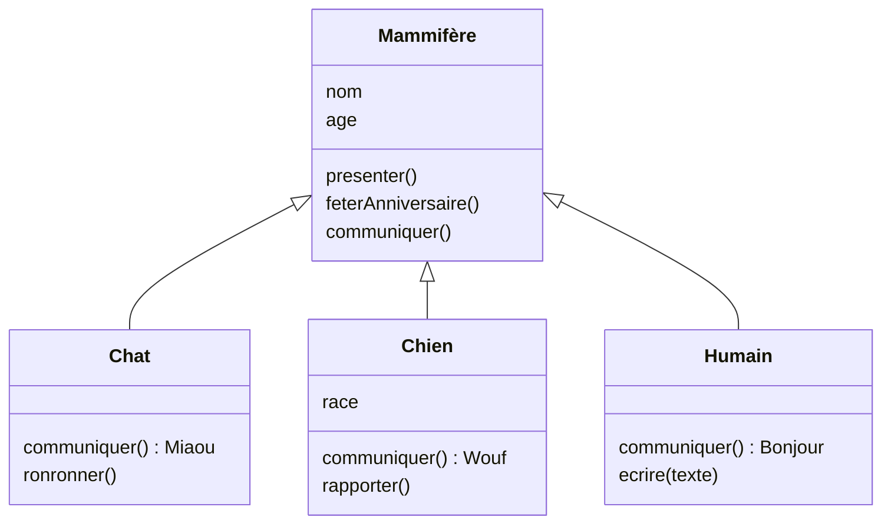
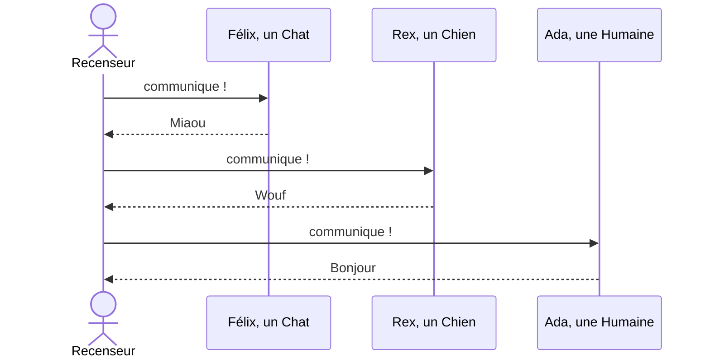
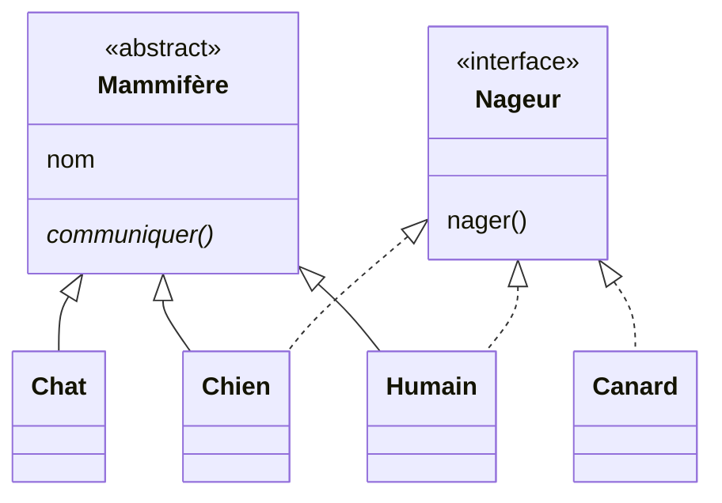
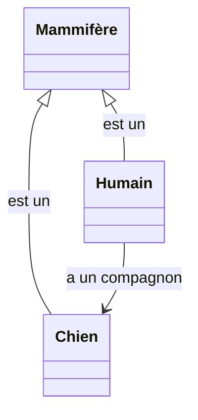

[← Chapitre précédent](05-Classes.md) · [Sommaire](Readme.md) · [Chapitre suivant →](07-Import-et-librairies.md)

# Héritage

## 🎯 Objectifs

À la fin de ce chapitre, vous saurez :

1. Expliquer la relation « est un » entre une classe enfant et sa classe parente, à partir des mammifères.
2. Écrire une classe qui hérite d'une autre, réutilise et redéfinit ses méthodes.
3. Tirer parti du polymorphisme.
4. Savoir quand préférer la composition à l'héritage.

---

## 1. L'idée : chats, chiens et humains sont des mammifères

Au chapitre précédent, Félix, Rex et Ada étaient de simples mammifères. Mais Félix est un **chat**, Rex un **chien**, Ada une **humaine**. Ils ont en commun tout ce qui fait un mammifère, et chacun a ses particularités :

- **ce qu'ils ont en commun** : un nom, un âge ; tous savent se présenter et fêter leur anniversaire ;
- **ce que chacun fait à sa façon** : tous communiquent, mais le chat miaule, le chien aboie, l'humain parle ;
- **ce que chacun est seul à faire** : le chat ronronne, le chien rapporte la balle, l'humain écrit.

Inutile de redire, pour chaque espèce, qu'elle a un nom et un âge : il suffit de dire qu'un chat **est un** mammifère, et tout ce qui est vrai des mammifères devient vrai des chats. Ne restent à décrire que les différences.



C'est l'**héritage** : une classe **enfant** reçoit les attributs et les méthodes de sa classe **parente**, puis **ajoute** ce qui lui est propre et **redéfinit** ce qui doit se comporter autrement.

| Dans la nature | En programmation |
|---|---|
| Mammifère, la catégorie générale | la classe **parente**, ou superclasse |
| Chat, Chien, Humain, les catégories particulières | les classes **enfants**, ou sous-classes |
| « un chat **est un** mammifère » | la relation d'**héritage** |
| tout chat a un nom et un âge, comme tout mammifère | l'enfant **hérite** des attributs et des méthodes du parent |
| le chat communique, mais en miaulant | la **redéfinition** (*override*) d'une méthode |
| seul le chat ronronne | l'**ajout** d'une méthode |

La relation ne se lit que dans un sens : tout chat est un mammifère, mais tout mammifère n'est pas un chat.

---

## 2. Hériter, redéfinir, appeler le parent

Les quatre classes, en code :

```python
class Mammifere:
    def __init__(self, nom, age=0):
        self.nom = nom
        self.age = age

    def communiquer(self):
        return "..."

    def presenter(self):
        return f"{self.nom}, {self.age} ans, dit : {self.communiquer()}"


class Chat(Mammifere):                     # Chat hérite de Mammifere
    def communiquer(self):                 # redéfinition
        return "Miaou"

    def ronronner(self):                   # ajout
        return f"{self.nom} ronronne"


class Chien(Mammifere):
    def __init__(self, nom, age, race):
        super().__init__(nom, age)         # le constructeur parent initialise nom et age
        self.race = race                   # attribut propre aux chiens

    def communiquer(self):
        return "Wouf"

    def rapporter(self):
        return f"{self.nom} rapporte la balle"


class Humain(Mammifere):
    def communiquer(self):
        return "Bonjour"

    def ecrire(self, texte):
        return f"{self.nom} écrit : {texte}"


felix = Chat("Félix", 3)
rex = Chien("Rex", 5, "labrador")
ada = Humain("Ada", 36)
print(felix.presenter())       # Félix, 3 ans, dit : Miaou   ← presenter() vient de Mammifere, communiquer() de Chat
print(felix.ronronner())       # Félix ronronne
print(rex.rapporter())         # Rex rapporte la balle
print(ada.ecrire("Bonjour"))   # Ada écrit : Bonjour
```

```javascript
class Mammifere {
  constructor(nom, age = 0) {
    this.nom = nom;
    this.age = age;
  }

  communiquer() {
    return "...";
  }

  presenter() {
    return `${this.nom}, ${this.age} ans, dit : ${this.communiquer()}`;
  }
}

class Chat extends Mammifere {
  communiquer() {
    return "Miaou";
  }

  ronronner() {
    return `${this.nom} ronronne`;
  }
}

class Chien extends Mammifere {
  constructor(nom, age, race) {
    super(nom, age);            // obligatoire avant d'utiliser this
    this.race = race;
  }

  communiquer() {
    return "Wouf";
  }

  rapporter() {
    return `${this.nom} rapporte la balle`;
  }
}

class Humain extends Mammifere {
  communiquer() {
    return "Bonjour";
  }

  ecrire(texte) {
    return `${this.nom} écrit : ${texte}`;
  }
}

const felix = new Chat("Félix", 3);
const rex = new Chien("Rex", 5, "labrador");
const ada = new Humain("Ada", 36);
console.log(felix.presenter());       // Félix, 3 ans, dit : Miaou
console.log(felix.ronronner());       // Félix ronronne
console.log(rex.rapporter());         // Rex rapporte la balle
console.log(ada.ecrire("Bonjour"));   // Ada écrit : Bonjour
```

```java
class Mammifere {
    protected final String nom;            // protected : visible des sous-classes
    protected int age;

    Mammifere(String nom, int age) {
        this.nom = nom;
        this.age = age;
    }

    String communiquer() { return "..."; }

    String presenter() { return nom + ", " + age + " ans, dit : " + communiquer(); }
}

class Chat extends Mammifere {
    Chat(String nom, int age) { super(nom, age); }

    @Override                              // le compilateur vérifie qu'on redéfinit bien une méthode
    String communiquer() { return "Miaou"; }

    String ronronner() { return nom + " ronronne"; }
}

class Chien extends Mammifere {
    private final String race;

    Chien(String nom, int age, String race) {
        super(nom, age);                   // appel du constructeur parent
        this.race = race;
    }

    @Override
    String communiquer() { return "Wouf"; }

    String rapporter() { return nom + " rapporte la balle"; }
}

class Humain extends Mammifere {
    Humain(String nom, int age) { super(nom, age); }

    @Override
    String communiquer() { return "Bonjour"; }

    String ecrire(String texte) { return nom + " écrit : " + texte; }
}

void main() {
    Chat felix = new Chat("Félix", 3);
    Chien rex = new Chien("Rex", 5, "labrador");
    Humain ada = new Humain("Ada", 36);
    IO.println(felix.presenter());       // Félix, 3 ans, dit : Miaou
    IO.println(felix.ronronner());       // Félix ronronne
    IO.println(rex.rapporter());         // Rex rapporte la balle
    IO.println(ada.ecrire("Bonjour"));   // Ada écrit : Bonjour
}
```

| | Python | JavaScript | Java |
|---|---|---|---|
| Hériter | `class Chat(Mammifere):` | `class Chat extends Mammifere` | `class Chat extends Mammifere` |
| Appeler le parent | `super().methode(…)` | `super.methode(…)` | `super.methode(…)` |
| Constructeur parent | `super().__init__(…)` | `super(…)` | `super(…)` |
| Marquer une redéfinition | — (décorateur `@override` facultatif, Python 3.12+) | — | `@Override` |

En Java, chaque enfant doit écrire son constructeur, ne serait-ce que pour appeler `super(…)` ; en Python et en JavaScript, un enfant sans constructeur reprend celui du parent, comme `Chat` et `Humain` ci-dessus.

---

## 3. Le polymorphisme

### L'idée : le recensement

Un agent recenseur fait le tour du quartier. À chaque porte, il pose la même question : « Présentez-vous. » Il ne sait pas à l'avance s'il va tomber sur un chat, un chien ou un humain, et il n'a pas besoin de le savoir : il s'adresse à des **mammifères**, et chacun répond **à sa façon**.



C'est le **polymorphisme**, « plusieurs formes » : un code écrit pour la classe **parente** fonctionne avec **n'importe quelle** classe enfant, et chaque objet répond avec **sa propre** version de la méthode.

### Le polymorphisme en code

```python
class Mammifere:
    def __init__(self, nom):
        self.nom = nom

    def communiquer(self):
        return "..."


class Chat(Mammifere):
    def communiquer(self):
        return "Miaou"


class Chien(Mammifere):
    def communiquer(self):
        return "Wouf"


class Humain(Mammifere):
    def communiquer(self):
        return "Bonjour"


recensement = [Chat("Félix"), Chien("Rex"), Humain("Ada"), Chien("Médor")]
for mammifere in recensement:
    print(mammifere.nom, ":", mammifere.communiquer())
# Félix : Miaou
# Rex : Wouf
# Ada : Bonjour
# Médor : Wouf
```

La boucle ne teste jamais « est-ce un chat, un chien ou un humain ? ». Ajouter demain une classe `Vache` ne demandera **aucune** modification de la boucle : c'est tout l'intérêt.

On vérifie au besoin l'appartenance à une classe, parente comprise, avec `isinstance(felix, Mammifere)` en Python, `felix instanceof Mammifere` en JavaScript et en Java.

---

## 4. Classes abstraites et interfaces

### L'idée : un mammifère « tout court » n'existe pas

Avez-vous déjà croisé un mammifère qui ne soit ni un chat, ni un chien, ni un humain, ni aucune autre espèce ? Jamais : « Mammifère » est une catégorie, pas un animal qu'on rencontre. Et tout mammifère communique, mais il n'existe pas de façon « générale » de communiquer : chaque espèce a la sienne.

En programmation, une telle classe est dite **abstraite** :

- on ne peut pas en créer d'instance ;
- elle sert de modèle commun à ses enfants ;
- elle peut leur **imposer** de fournir certaines méthodes : « tout mammifère doit savoir communiquer, à sa façon ».

Il existe aussi des capacités qui **ne suivent pas** les familles. Le chien et l'humain savent nager, le chat évite l'eau, et le canard nage aussi, sans être un mammifère. « Savoir nager » n'est pas une catégorie, c'est un **contrat** : quiconque le remplit peut aller à la piscine. C'est l'idée d'**interface** : elle décrit ce qu'un objet **sait faire**, indépendamment de ce qu'il **est**.



### Classes abstraites et interfaces en code

En Python, une classe abstraite hérite de `ABC`, et marque ses méthodes obligatoires avec `@abstractmethod` :

```python
from abc import ABC, abstractmethod

class Mammifere(ABC):
    def __init__(self, nom):
        self.nom = nom

    @abstractmethod
    def communiquer(self): ...           # pas de corps : chaque enfant doit la fournir


class Chat(Mammifere):
    def communiquer(self):
        return "Miaou"


print(Chat("Félix").communiquer())       # Miaou
try:
    Mammifere("?")
except TypeError as erreur:
    print("TypeError :", erreur)
    # Can't instantiate abstract class Mammifere without an implementation for abstract method 'communiquer'
```

Java a les deux outils : la classe **abstraite** (`abstract class`) et l'**interface**, un contrat sans état. Une classe n'hérite que d'**une** classe, mais peut implémenter **plusieurs** interfaces.

```java
interface Nageur {
    String nager();                          // à fournir par toute classe qui implémente Nageur
}

abstract class Mammifere {
    protected final String nom;

    Mammifere(String nom) { this.nom = nom; }

    abstract String communiquer();           // pas de corps : chaque enfant doit la fournir
}

class Chat extends Mammifere {
    Chat(String nom) { super(nom); }
    String communiquer() { return "Miaou"; }
}

class Chien extends Mammifere implements Nageur {
    Chien(String nom) { super(nom); }
    String communiquer() { return "Wouf"; }
    public String nager() { return nom + " nage la tête hors de l'eau"; }
}

class Humain extends Mammifere implements Nageur {
    Humain(String nom) { super(nom); }
    String communiquer() { return "Bonjour"; }
    public String nager() { return nom + " nage le crawl"; }
}

class Canard implements Nageur {             // pas un mammifère, mais il nage
    public String nager() { return "Le canard flotte"; }
}

void main() {
    // new Mammifere("?");                   ← refusé à la compilation : Mammifere is abstract
    IO.println(new Chat("Félix").communiquer());   // Miaou

    List<Nageur> piscine = List.of(new Chien("Rex"), new Humain("Ada"), new Canard());
    for (Nageur n : piscine) {
        IO.println(n.nager());
    }
    // Rex nage la tête hors de l'eau
    // Ada nage le crawl
    // Le canard flotte
}
```

JavaScript n'a ni classe abstraite ni interface. Comme Python, il s'appuie sur le *duck typing* (« si ça cancane comme un canard… ») : tout objet qui possède la bonne méthode convient. TypeScript ajoute des interfaces vérifiées à la compilation.

---

## 5. Héritage ou composition ?

### L'idée : « est un » ou « a un » ?

Ada **a** un chien, Rex. Elle n'**est** pas un chien : il serait absurde que la classe `Humain` hérite de `Chien` pour qu'Ada puisse jouer à la balle. Ada possède un chien, et lui demande de rapporter la balle.



Avant d'hériter, posez-vous la question :

- **« est un »** → l'héritage peut convenir : un chat **est un** mammifère, un compte épargne **est un** compte ;
- **« a un »** → préférez la **composition**, c'est-à-dire un attribut : un humain **a un** chien, une voiture **a un** moteur.

L'héritage crée un lien fort : toute modification de la classe parente se répercute sur ses enfants, et une hiérarchie profonde devient vite difficile à faire évoluer. La composition, elle, assemble des objets indépendants.

### La composition en code

```python
class Chien:
    def __init__(self, nom):
        self.nom = nom

    def rapporter(self):
        return f"{self.nom} rapporte la balle"


class Humain:
    def __init__(self, nom, compagnon):
        self.nom = nom
        self.compagnon = compagnon         # composition : Ada A un chien

    def jouer(self):
        return f"{self.nom} lance la balle. {self.compagnon.rapporter()}"


ada = Humain("Ada", Chien("Rex"))
print(ada.jouer())                         # Ada lance la balle. Rex rapporte la balle
```

La règle répandue : **composition par défaut**, héritage quand la relation « est un » est évidente et stable.

---

## 6. Exercice

Reprenez la classe `Compte` du chapitre 05 (titulaire, solde, `deposer`, `retirer`) et écrivez une classe `CompteEpargne` qui :

1. hérite de `Compte` ;
2. ajoute un attribut `taux` (par exemple 0.03 pour 3 %) ;
3. ajoute une méthode `appliquer_interets()` qui crédite les intérêts annuels ;
4. redéfinit `retirer` pour refuser tout retrait supérieur à 1 000 €, en réutilisant pour le reste la méthode du parent.

<details>
<summary>Voir la correction</summary>

```python
class Compte:
    def __init__(self, titulaire, solde=0):
        self.titulaire = titulaire
        self._solde = solde

    def deposer(self, montant):
        if montant <= 0:
            raise ValueError("Le montant doit être positif")
        self._solde += montant

    def retirer(self, montant):
        if montant > self._solde:
            raise ValueError("Solde insuffisant")
        self._solde -= montant

    @property
    def solde(self):
        return self._solde


class CompteEpargne(Compte):
    PLAFOND_RETRAIT = 1000

    def __init__(self, titulaire, solde=0, taux=0.03):
        super().__init__(titulaire, solde)
        self.taux = taux

    def appliquer_interets(self):
        self.deposer(round(self.solde * self.taux, 2))

    def retirer(self, montant):
        if montant > self.PLAFOND_RETRAIT:
            raise ValueError("Retrait plafonné à 1000 €")
        super().retirer(montant)          # la vérification du solde reste celle du parent


livret = CompteEpargne("Ada", 5000)
livret.appliquer_interets()
print(livret.solde)                       # 5150.0
livret.retirer(500)
print(livret.solde)                       # 4650.0
try:
    livret.retirer(2000)
except ValueError as erreur:
    print(erreur)                         # Retrait plafonné à 1000 €
print(isinstance(livret, Compte))         # True
```

```javascript
class Compte {
  #solde;
  constructor(titulaire, solde = 0) {
    this.titulaire = titulaire;
    this.#solde = solde;
  }
  deposer(montant) {
    if (montant <= 0) throw new RangeError("Le montant doit être positif");
    this.#solde += montant;
  }
  retirer(montant) {
    if (montant > this.#solde) throw new RangeError("Solde insuffisant");
    this.#solde -= montant;
  }
  get solde() {
    return this.#solde;
  }
}

class CompteEpargne extends Compte {
  static PLAFOND_RETRAIT = 1000;

  constructor(titulaire, solde = 0, taux = 0.03) {
    super(titulaire, solde);
    this.taux = taux;
  }

  appliquerInterets() {
    this.deposer(Math.round(this.solde * this.taux * 100) / 100);
  }

  retirer(montant) {
    if (montant > CompteEpargne.PLAFOND_RETRAIT) {
      throw new RangeError("Retrait plafonné à 1000 €");
    }
    super.retirer(montant);
  }
}

const livret = new CompteEpargne("Ada", 5000);
livret.appliquerInterets();
console.log(livret.solde);                // 5150
livret.retirer(500);
console.log(livret.solde);                // 4650
try {
  livret.retirer(2000);
} catch (erreur) {
  console.log(erreur.message);            // Retrait plafonné à 1000 €
}
console.log(livret instanceof Compte);    // true
```

```java
class Compte {
    private final String titulaire;
    private double solde;

    Compte(String titulaire, double solde) {
        this.titulaire = titulaire;
        this.solde = solde;
    }

    void deposer(double montant) {
        if (montant <= 0) throw new IllegalArgumentException("Le montant doit être positif");
        solde += montant;
    }

    void retirer(double montant) {
        if (montant > solde) throw new IllegalArgumentException("Solde insuffisant");
        solde -= montant;
    }

    double getSolde() { return solde; }
}

class CompteEpargne extends Compte {
    static final double PLAFOND_RETRAIT = 1000;
    private final double taux;

    CompteEpargne(String titulaire, double solde, double taux) {
        super(titulaire, solde);
        this.taux = taux;
    }

    void appliquerInterets() {
        deposer(Math.round(getSolde() * taux * 100) / 100.0);
    }

    @Override
    void retirer(double montant) {
        if (montant > PLAFOND_RETRAIT) {
            throw new IllegalArgumentException("Retrait plafonné à 1000 €");
        }
        super.retirer(montant);
    }
}

void main() {
    CompteEpargne livret = new CompteEpargne("Ada", 5000, 0.03);
    livret.appliquerInterets();
    IO.println(livret.getSolde());            // 5150.0
    livret.retirer(500);
    IO.println(livret.getSolde());            // 4650.0
    try {
        livret.retirer(2000);
    } catch (IllegalArgumentException erreur) {
        IO.println(erreur.getMessage());      // Retrait plafonné à 1000 €
    }
    IO.println(livret instanceof Compte);     // true
}
```

`super().retirer(…)` réutilise la règle « solde suffisant » du parent au lieu de la recopier : si elle change un jour, l'enfant en profitera sans modification.

</details>

---

[← Chapitre précédent](05-Classes.md) · [Sommaire](Readme.md) · [Chapitre suivant →](07-Import-et-librairies.md)
