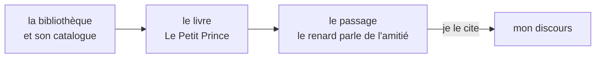
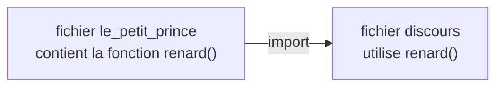
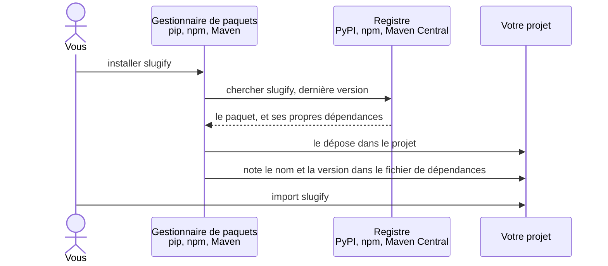
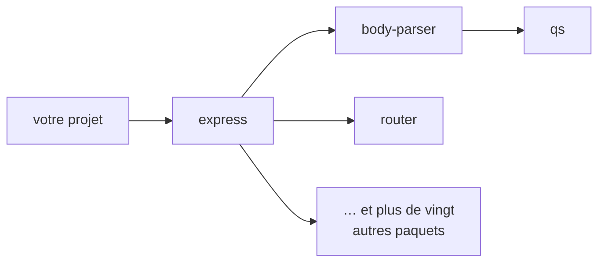

[← Chapitre précédent](06-Heritage.md) · [Sommaire](Readme.md) · [Chapitre suivant →](A-Aide-memoire.md)

# Import et librairies

## 🎯 Objectifs

À la fin de ce chapitre, vous saurez :

1. Expliquer ce qu'est un import, en le comparant à l'emprunt d'un livre en bibliothèque.
2. Découper un programme en modules et importer ce dont un fichier a besoin.
3. Utiliser la bibliothèque standard de votre langage.
4. Installer une librairie tierce avec le gestionnaire de paquets du langage, et la choisir avec discernement.

---

## 1. L'idée : emprunter un livre à la bibliothèque

Vous préparez un discours sur l'amitié. Vous pourriez tout écrire vous-même ; mais un auteur l'a déjà dit mieux que vous. Vous allez donc à la **bibliothèque**, vous cherchez *Le Petit Prince* dans le catalogue, vous trouvez le livre sur son rayon, et vous ouvrez le chapitre où le renard explique ce qu'est l'amitié : « On ne voit bien qu'avec le cœur. L'essentiel est invisible pour les yeux. » Vous **importez** ce passage dans votre discours, en citant sa source.



Vous n'avez pas réécrit le livre, ni même recopié tout le livre : vous êtes allé chercher **le passage dont vous aviez besoin**, et vous l'utilisez. Programmer, c'est pareil : lire un fichier, calculer une racine carrée, manipuler des dates ou parler à une base de données sont des problèmes déjà résolus, par d'autres, dans des livres de code. L'**import** est l'instruction qui fait entrer dans votre programme du code écrit ailleurs.

| À la bibliothèque | En programmation |
|---|---|
| un livre : *Le Petit Prince* | un **module**, ou une **librairie** : un fichier, ou un ensemble de fichiers, de code |
| un passage du livre : le renard parle de l'amitié | une **fonction**, une classe ou une constante du module |
| citer le passage dans mon discours, en nommant le livre | **importer** |
| mes propres carnets de notes | **mes modules** : les autres fichiers de mon projet |
| les ouvrages toujours à portée de main : dictionnaire, atlas | la **bibliothèque standard**, livrée avec le langage |
| la bibliothèque municipale et son catalogue | le **registre** de paquets : PyPI, npm, Maven Central |
| le bibliothécaire qui va chercher le livre en réserve | le **gestionnaire de paquets** : `pip`, `npm`, Maven |
| l'édition précise du livre, dont dépend la page citée | la **version** de la librairie |

Deux façons de citer, deux façons d'importer :

- « Comme l'écrit Saint-Exupéry dans *Le Petit Prince*… » : on apporte le livre entier, et l'on nomme la source à chaque citation ;
- on photocopie seulement le passage du renard, et l'on s'en sert directement, sans répéter à chaque fois de quel livre il vient.

> « Librairie » est un faux-ami : en français, une librairie **vend** des livres, une **bibliothèque** les **prête**. Le mot anglais *library* désigne une bibliothèque, et l'image est la bonne : la plupart des librairies de code sont libres, on les emprunte sans les payer. Les deux termes s'emploient.

---

## 2. Du livre au module

Passons au code. Pour l'expérience, écrivons nous-mêmes le livre : un fichier `le_petit_prince`, qui contient une fonction `renard()`. Un autre fichier, `discours`, va l'importer.



**Python** : tout fichier `.py` est un module, importable par son nom.

```text
projet/
├── le_petit_prince.py
└── discours.py
```

`le_petit_prince.py` :

```python
def renard():
    return "On ne voit bien qu'avec le cœur. L'essentiel est invisible pour les yeux."
```

`discours.py` :

```python
import le_petit_prince                      # j'apporte le livre entier...
from le_petit_prince import renard          # ... ou je ne prends que le passage

print("Comme le dit le renard :", le_petit_prince.renard())   # je nomme la source
print(renard())                                               # je m'en sers directement
# Comme le dit le renard : On ne voit bien qu'avec le cœur. L'essentiel est invisible pour les yeux.
# On ne voit bien qu'avec le cœur. L'essentiel est invisible pour les yeux.
```

Lancement : `python discours.py`.

**JavaScript** : un module **exporte** explicitement ce qu'il partage, avec `export`. Un passage non exporté reste dans le livre : on ne peut pas le citer. On utilise l'extension `.mjs`, ou bien `"type": "module"` dans le fichier `package.json` du projet.

`le-petit-prince.mjs` :

```javascript
export function renard() {
  return "On ne voit bien qu'avec le cœur. L'essentiel est invisible pour les yeux.";
}
```

`discours.mjs` :

```javascript
import * as lePetitPrince from "./le-petit-prince.mjs";   // le livre entier...
import { renard } from "./le-petit-prince.mjs";           // ... ou seulement le passage

console.log("Comme le dit le renard :", lePetitPrince.renard());   // je nomme la source
console.log(renard());                                             // je m'en sers directement
```

Lancement : `node discours.mjs`.

**Java** : chaque classe publique vit dans son propre fichier, au nom de la classe. Les classes d'un même dossier (d'un même **paquet**) se voient sans import.

`LePetitPrince.java` :

```java
public class LePetitPrince {
    public static String renard() {
        return "On ne voit bien qu'avec le cœur. L'essentiel est invisible pour les yeux.";
    }
}
```

`Discours.java` :

```java
void main() {
    IO.println("Comme le dit le renard : " + LePetitPrince.renard());
}
```

Lancement : `java Discours.java`. Depuis Java 22, cette commande compile au besoin les autres fichiers du dossier. Dans un vrai projet, les classes se rangent en paquets (`package fr.diginamic.livres;`), s'importent avec `import fr.diginamic.livres.LePetitPrince;`, et un outil de construction, Maven ou Gradle, se charge de la compilation.

| | Python | JavaScript | Java |
|---|---|---|---|
| Unité | le fichier (module), le dossier (paquet) | le fichier (module) | la classe, rangée dans un paquet |
| Partager | tout est importable ; `_nom` signale l'interne | `export` explicite | `public` |
| Importer le livre entier | `import le_petit_prince` | `import * as lpp from "./…mjs"` | `import paquet.LePetitPrince;` |
| Importer un passage | `from le_petit_prince import renard` | `import { renard } from "./…mjs"` | `import static paquet.LePetitPrince.renard;` |

> Importez **précisément** ce dont vous avez besoin. Évitez `from module import *` en Python : on ne sait plus d'où vient chaque nom, et deux modules peuvent se marcher dessus, comme un discours fait de citations dont on aurait perdu les sources.

---

## 3. La bibliothèque standard : les ouvrages toujours à portée de main

Sur votre bureau, le dictionnaire et l'atlas sont toujours là : pas besoin d'aller à la bibliothèque. Chaque langage est livré de même avec une **bibliothèque standard** : des modules toujours disponibles, sans rien installer.

```python
import math                          # tout le module, utilisé avec le préfixe math.
from datetime import date            # un seul élément, utilisé directement

print(math.sqrt(16), math.pi)        # 4.0 3.141592653589793
print(date(2026, 10, 7).isoformat()) # 2026-10-07
```

```javascript
import { readdirSync } from "node:fs";   // module fourni par Node.js
import path from "node:path";

console.log(Math.sqrt(16), Math.PI);     // 4 3.141592653589793  (Math est global, sans import)
console.log(path.extname("rapport.pdf"));                  // .pdf
console.log(Array.isArray(readdirSync(".")));             // true
```

```java
import java.time.LocalDate;            // une classe précise

void main() {
    IO.println(Math.sqrt(16) + " " + Math.PI);   // 4.0 3.141592653589793
    IO.println(LocalDate.of(2026, 10, 7));       // 2026-10-07
}
```

Certains ouvrages sont même ouverts sur la table en permanence : ce que chaque langage rend disponible **sans import** :

- **Python** : les fonctions intégrées (`print`, `len`, `int`…) ;
- **JavaScript** : les objets globaux (`Math`, `JSON`, `console`…) ;
- **Java** : le paquet `java.lang` (`String`, `Math`…). Les **fichiers source compacts** de Java 25, utilisés dans ce cours, importent en plus automatiquement tout le module `java.base` (`List`, `Map`, `LocalDate`…) : l'`import` ci-dessus y est donc facultatif, mais il reste obligatoire dans un fichier Java classique.

---

## 4. Installer une librairie tierce : la bibliothèque municipale

Quand le livre n'est pas sur votre bureau, vous le demandez à la bibliothèque municipale. Chaque langage a la sienne, un **registre** public où sont publiées les librairies, et son bibliothécaire, le **gestionnaire de paquets**, qui va chercher le livre et le pose sur votre étagère.



| | Python | JavaScript | Java |
|---|---|---|---|
| Registre | PyPI | npm | Maven Central |
| Outil | `pip` (ou `uv`) | `npm` | Maven ou Gradle |
| Dépendances déclarées dans | `pyproject.toml` ou `requirements.txt` | `package.json` | `pom.xml` ou `build.gradle` |
| Installées dans | un environnement virtuel `.venv/` | `node_modules/` | un cache partagé (`~/.m2`) |

Exemple : la même tâche, transformer un titre en identifiant d'URL (un *slug*), avec une librairie dans chaque langage.

**Python**, dans un **environnement virtuel**, qui isole les librairies de chaque projet comme une étagère réservée :

```bash
python -m venv .venv
source .venv/bin/activate          # Windows : .venv\Scripts\activate
pip install python-slugify
```

```python
from slugify import slugify

print(slugify("Concepts généraux en programmation"))   # concepts-generaux-en-programmation
```

**JavaScript** :

```bash
npm install slugify                # ajoute la dépendance à package.json et l'installe dans node_modules/
```

```javascript
import slugify from "slugify";

console.log(slugify("Concepts généraux en programmation", { lower: true }));
// concepts-generaux-en-programmation
```

**Java**, avec Maven : on déclare la dépendance dans `pom.xml`, et Maven la télécharge à la construction. Ici, Jackson, la librairie de référence pour le JSON (chapitre 04) :

```xml
<dependency>
    <groupId>tools.jackson.core</groupId>
    <artifactId>jackson-databind</artifactId>
    <version>3.2.1</version>
</dependency>
```

> Le nom d'installation et le nom d'import ne coïncident pas toujours, comme la cote d'un livre en rayon diffère de son titre : on installe `python-slugify`, on importe `slugify`. La documentation de la librairie l'indique toujours.

---

## 5. Choisir une librairie, et la tenir à jour

Un livre emprunté entre dans votre discours ; une librairie installée entre dans votre programme, et vous en devenez en partie responsable. Avant d'installer :

- **Est-ce vraiment nécessaire ?** Une fonction de trois lignes ne justifie pas une dépendance. Regardez d'abord la bibliothèque standard.
- **Est-elle maintenue ?** Date de la dernière version, réponses aux tickets, nombre de mainteneurs.
- **Est-elle répandue ?** Nombre de téléchargements, de projets qui l'utilisent.
- **Sa licence est-elle compatible** avec votre projet ?
- **Le titre est-il exact ?** Des paquets malveillants imitent les noms de librairies connues, comme une contrefaçon intitulée *Le Petit Prinse* : `reqeusts` au lieu de `requests`. C'est le *typosquatting*.

Une librairie en emprunte souvent d'autres, qui en empruntent à leur tour : installer un paquet en fait entrer des dizaines.



Une fois installée :

- **versionnez le fichier de verrouillage** (`package-lock.json`, `uv.lock`…) : il note l'édition exacte de chaque livre emprunté, pour que toute l'équipe et la production installent les mêmes ;
- **ne versionnez pas** le dossier des librairies installées (`node_modules/`, `.venv/`) : il se reconstruit à partir des fichiers de dépendances, comme on peut toujours ré-emprunter un livre ;
- **mettez à jour régulièrement**, et surveillez les failles connues : `npm audit`, `pip-audit`, ou les alertes automatiques de GitHub (Dependabot).

---

## 6. Exercice

1. Écrivez un module `geometrie` contenant une fonction `aire_cercle(rayon)` qui utilise la constante π de la bibliothèque standard.
2. Importez-la depuis un fichier principal, et affichez l'aire d'un cercle de rayon 2, arrondie à deux décimales.
3. *(Python ou JavaScript)* Installez la librairie `slugify` du langage, et transformez « Héritage & polymorphisme » en slug.

<details>
<summary>Voir la correction</summary>

**Python** — `geometrie.py` :

```python
import math

def aire_cercle(rayon):
    return math.pi * rayon ** 2
```

`main.py` :

```python
from geometrie import aire_cercle
from slugify import slugify          # après : pip install python-slugify

print(round(aire_cercle(2), 2))                 # 12.57
print(slugify("Héritage & polymorphisme"))      # heritage-polymorphisme
```

**JavaScript** — `geometrie.mjs` :

```javascript
export function aireCercle(rayon) {
  return Math.PI * rayon ** 2;
}
```

`main.mjs` :

```javascript
import { aireCercle } from "./geometrie.mjs";
import slugify from "slugify";       // après : npm install slugify

console.log(aireCercle(2).toFixed(2));                                 // 12.57
console.log(slugify("Héritage & polymorphisme", { lower: true }));     // heritage-and-polymorphisme
```

**Java** — `Geometrie.java` :

```java
public class Geometrie {
    public static double aireCercle(double rayon) {
        return Math.PI * rayon * rayon;
    }
}
```

`Main.java` :

```java
void main() {
    IO.println(Math.round(Geometrie.aireCercle(2) * 100) / 100.0);   // 12.57
}
```

Remarquez la différence de traitement du `&` : la librairie Python le supprime, la librairie JavaScript le remplace par le mot `and`. Deux livres au même titre ne disent pas forcément la même chose : lisez la documentation, et testez.

</details>

---

[← Chapitre précédent](06-Heritage.md) · [Sommaire](Readme.md) · [Chapitre suivant →](A-Aide-memoire.md)
