# Concepts généraux en programmation

### Les langages changent, les concepts restent

<!-- Demander en début de séance quels langages les participants connaissent déjà : on s'appuiera dessus. -->

---

## 🎯 Objectifs pédagogiques

À la fin de ce cours, vous saurez :

1. Utiliser variables et constantes, et bien les nommer
2. Reconnaître les types, et manipuler un texte comme une suite de caractères
3. Manipuler listes et tableaux associatifs
4. Expliquer ce qu'est un objet
5. Écrire une classe et protéger son état
6. Utiliser l'héritage et le polymorphisme
7. Importer des modules et des librairies

---

## La méthode : l'idée d'abord, le code ensuite

Chaque concept commence **sans code**, par une image du quotidien :

| Concept | L'image |
|---|---|
| Variable, constante | une boîte étiquetée, un sac |
| Type, chaîne de caractères | la nature du contenu ; des perles sur un fil |
| Liste, tableau associatif | une feuille de tableur |
| Objet | un compte en banque |
| Classe, héritage | la classe des mammifères : chat, chien, humain |
| Import, librairie | emprunter *Le Petit Prince* à la bibliothèque |

Puis le même concept, écrit dans trois langages.

---

## Trois langages, côte à côte

| Langage | Version | Lancer |
|---|---|---|
| Python | 3.14 | `python exemple.py` |
| JavaScript | Node.js 24 LTS | `node exemple.mjs` |
| Java | Java 25 LTS | `java Exemple.java` |

- Typage **dynamique** (Python, JavaScript) et **statique** (Java)
- Suivez votre langage, regardez les autres : ce qui change, c'est la **syntaxe**

---

## Le parcours

| #  | Étape                     | L'image                     |
|----|---------------------------|-----------------------------|
| 01 | Variables et constantes   | boîtes et sacs              |
| 02 | Types                     | perles sur un fil           |
| 03 | Tableaux et listes        | feuille de tableur          |
| 04 | Objets                    | compte en banque            |
| 05 | Classes                   | la classe des mammifères    |
| 06 | Héritage                  | chat, chien, humain         |
| 07 | Import et librairies      | la bibliothèque             |

---

# 1. Variables et constantes

---

## L'idée : des boîtes étiquetées

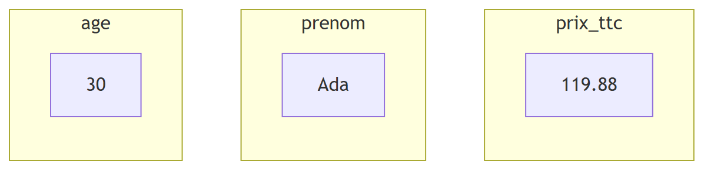

| Geste avec la boîte | En programmation |
|---|---|
| écrire un nom sur l'étiquette | **déclarer** |
| ranger une valeur dans la boîte | **affecter** |
| regarder dedans, sans la vider | **lire** |
| vider la boîte, ranger autre chose | **réaffecter** |

<!-- Si possible, apporter de vraies boîtes et des post-it : l'image se retient mieux quand on la manipule. -->

---

## Lire de droite à gauche

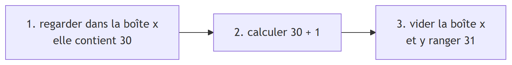

> `=` n'est pas l'égalité des maths : c'est un **rangement**, qui se lit de droite à gauche.

---

## Les constantes : des boîtes scellées

On peut toujours regarder dedans, plus en changer le contenu.

| Le scellé ressemble à… | Si l'on touche à la boîte | Langage |
|---|---|---|
| un autocollant « Ne pas toucher » | rien ne l'empêche : c'est une convention | Python |
| une alarme | erreur à l'exécution | JavaScript |
| un contrôle à l'entrée | programme refusé avant de démarrer | Java |

---

## L'étiquette cousue sur le sac

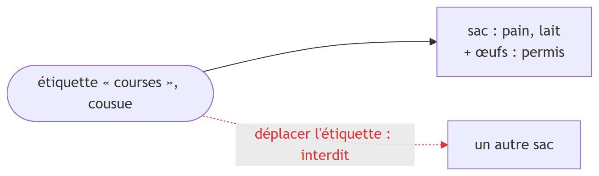

> **Constante ne veut pas dire immuable** : ce qui est fixé, c'est le lien entre l'étiquette et le sac, pas le contenu du sac.

---

## En code : un nom pour une valeur

| Python | JavaScript | Java |
|---|---|---|
| `age = 30` | `let age = 30;` | `int age = 30;` |
| `prenom = "Ada"` | `let prenom = "Ada";` | `String prenom = "Ada";` |
| `age = age + 1` | `age = age + 1;` | `age = age + 1;` |

| Langage | Constante | Garantie |
|---|---|---|
| Python | `TAUX_TVA: Final = 0.20` | convention ; vérifiée par mypy/Pyright |
| JavaScript | `const TAUX_TVA = 0.20;` | erreur à l'exécution |
| Java | `final double TAUX_TVA = 0.20;` | erreur à la compilation |

Par défaut : `const` / `final`, sauf si la valeur doit changer.

---

## Bien nommer

Une boîte marquée « divers » oblige à l'ouvrir ; « vaisselle fragile » se comprend seule.

| Convention | Forme | Pour |
|---|---|---|
| *snake_case* | `prix_ttc` | Python |
| *camelCase* | `prixTtc` | JavaScript, Java |
| *UPPER_SNAKE_CASE* | `TAUX_TVA` | constantes |
| *PascalCase* | `CompteBancaire` | classes |

`nb_tentatives` plutôt que `n` : un bon nom vaut un commentaire.

---

# 2. Types

---

## L'idée : chaque valeur a une nature

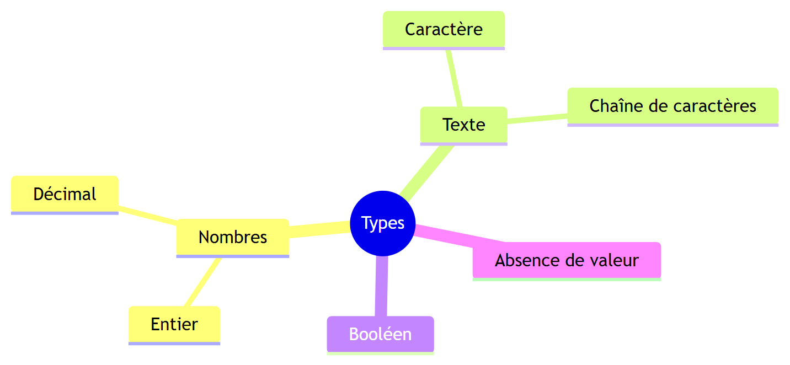

On additionne deux âges, on met un prénom en majuscules, mais pas l'inverse. Le **type** dit ce qu'est une valeur, et ce qu'on peut en faire.

---

## Un texte est une suite de caractères

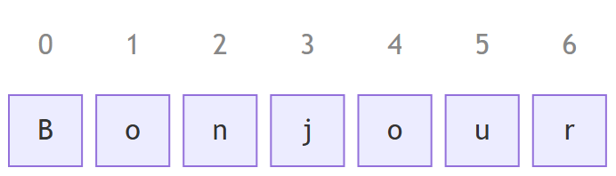

- une **longueur** : 7 ; une **position** : en 3, « j » ; un **morceau** : « Bon »
- on la **parcourt** caractère par caractère : c'est une **liste de caractères**
- **immuable** : pour changer une lettre, on fabrique une nouvelle chaîne
- un caractère est un **nombre** déguisé : « A » porte le numéro 65 (Unicode)

---

## Boîte à forme ou boîte universelle ?

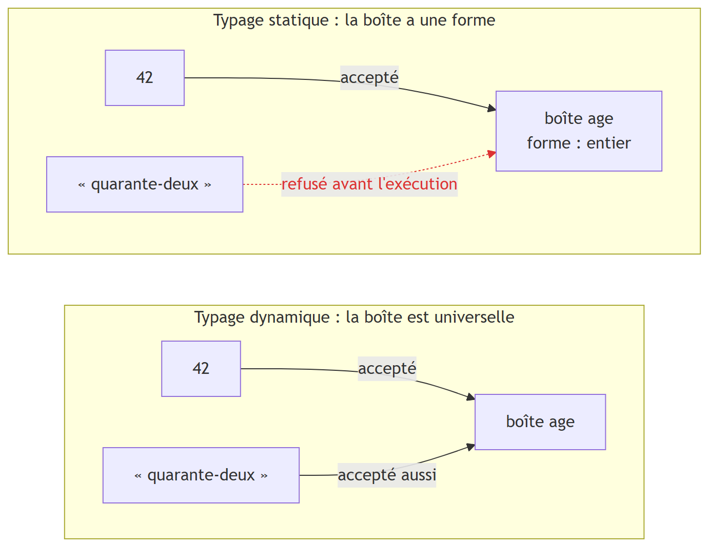

**Statique** : la boîte a une forme, vérifiée **avant** l'exécution
Java, C#, TypeScript

**Dynamique** : la boîte est universelle, c'est la valeur qui a un type
Python, JavaScript

---

## Refuser ou convertir en silence ?

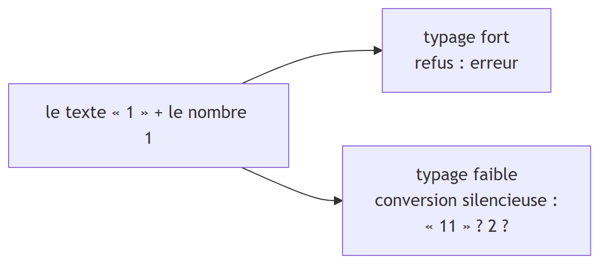

- **Typage fort** : le langage refuse, et demande de préciser
- **Typage faible** : il convertit en silence, parfois de travers

---

## Les types de base

| Famille | Python | JavaScript | Java |
|---|---|---|---|
| Entier | `int` | `number` | `int`, `long` |
| Décimal | `float` | `number` | `double` |
| Booléen | `True` / `False` | `true` / `false` | `true` / `false` |
| Caractère | (chaîne de longueur 1) | (chaîne de longueur 1) | `char` : `'B'` |
| Texte | `str` | `string` | `String` |
| Rien | `None` | `null`, `undefined` | `null` |

---

## Les chaînes en code

| | Python | JavaScript | Java |
|---|---|---|---|
| Longueur | `len(mot)` | `mot.length` | `mot.length()` |
| Caractère en `i` | `mot[i]` | `mot[i]` | `mot.charAt(i)` |
| Morceau | `mot[0:3]` | `mot.slice(0, 3)` | `mot.substring(0, 3)` |
| Liste des caractères | `list(mot)` | `[...mot]` | `mot.toCharArray()` |
| Numéro Unicode | `ord("A")` | `"A".codePointAt(0)` | `(int) 'A'` |

> En Java, `'B' + 'j'` vaut **172** : deux `char` s'additionnent comme des nombres.

---

## Statique ou dynamique ? Fort ou faible ?

| | Vérifié quand ? | Exemples |
|---|---|---|
| **Statique** | à la compilation | Java, TypeScript |
| **Dynamique** | à l'exécution | Python, JavaScript |

```text
"1" + 1     Python : TypeError     JavaScript : "11"     Java : "11"
"5" - 2     Python : TypeError     JavaScript : 3        Java : refusé à la compilation
```

> En JavaScript : toujours `===`, jamais `==`.

---

## Convertir, et deux pièges

| | Python | JavaScript | Java |
|---|---|---|---|
| Texte → entier | `int("42")` | `Number("42")` | `Integer.parseInt("42")` |
| Échec | `ValueError` | `NaN` (silencieux !) | `NumberFormatException` |

```text
7 / 2        Python : 3.5    JavaScript : 3.5    Java : 3   ← deux int
0.1 + 0.2    0.30000000000000004, dans les trois langages
```

Pour de l'argent : centimes entiers, `Decimal`, `BigDecimal`.

---

# 3. Tableaux et listes

---

## L'idée : une colonne de tableur

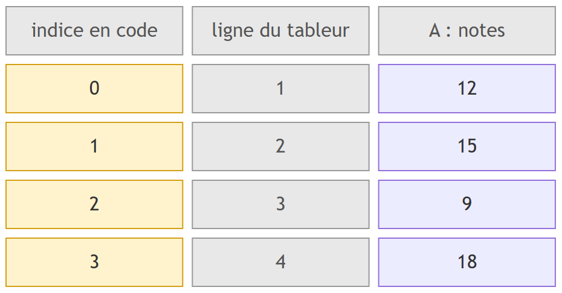

- Une **liste**, c'est une colonne : une valeur par cellule
- Chaque cellule a une position : son **indice**
- Le tableur compte à partir de **1**, le code à partir de **0**
- Le dernier indice vaut **longueur – 1**

---

## Les gestes du tableur ont tous un équivalent

| Dans le tableur | Dans une liste |
|---|---|
| lire la cellule A3 | lire l'élément d'indice 2 |
| remplir la première ligne vide | **ajouter** à la fin |
| « Insérer une ligne » | **insérer** |
| « Supprimer la ligne » | **retirer** |
| le filtre automatique | **filtrer** |
| une formule recopiée vers le bas | **transformer** |
| `=SOMME(A1:A4)` | **réduire** |

---

## Supprimer une ligne décale les suivantes

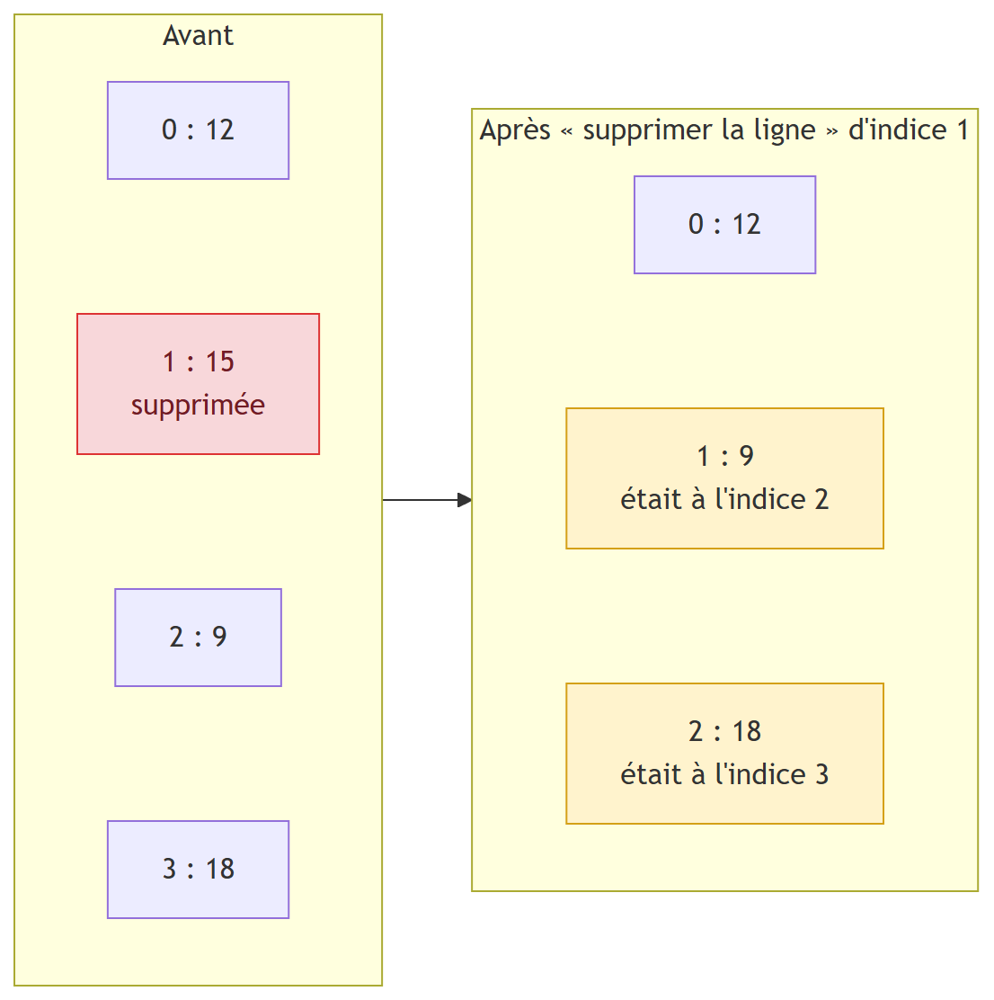

Après un retrait, les éléments du dessous **changent d'indice**.

Boîte à œufs ou colonne de tableur ?

- **tableau** : taille fixe (`int[]` en Java)
- **liste** : taille libre (`list`, `Array`, `ArrayList`)

---

## Filtrer, transformer, réduire

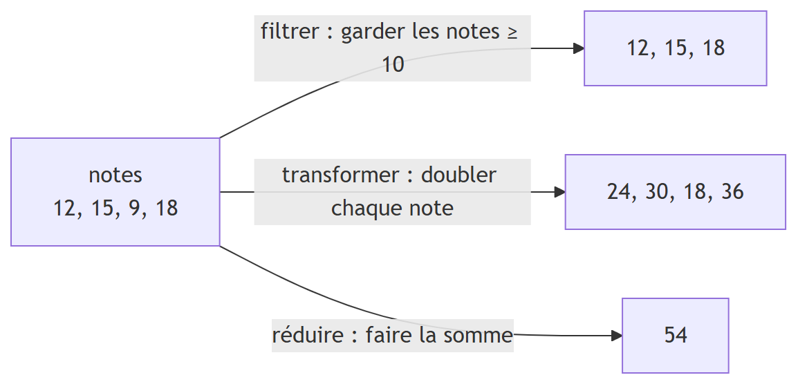

Le résultat est une **nouvelle** valeur : la colonne d'origine ne change pas.

---

## Le tableau associatif : deux colonnes

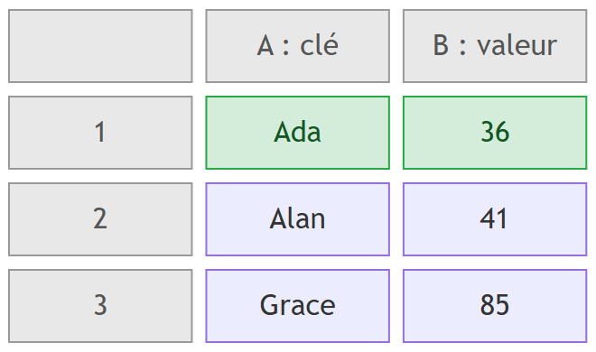

- Colonne A : la **clé**, par laquelle on cherche
- Colonne B : la **valeur**, en face
- C'est `RECHERCHEV` : chercher « Ada », lire 36
- Chaque clé est **unique**
- Clé absente : l'équivalent de `#N/A`

---

## Une feuille avec des en-têtes

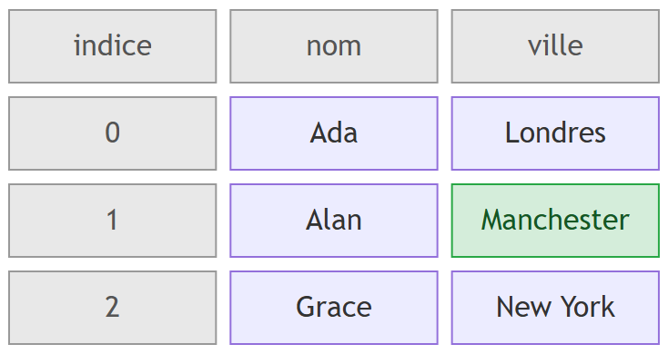

Une **liste** de lignes ; chaque ligne est un **tableau associatif** dont les clés sont les en-têtes.

Partout : base de données, fichier CSV, réponse JSON.

---

## Des valeurs rangées par indice

| | Python | JavaScript | Java |
|---|---|---|---|
| Créer | `[12, 15, 9]` | `[12, 15, 9]` | `new ArrayList<>(List.of(12, 15, 9))` |
| Lire | `notes[0]` | `notes[0]` | `notes.get(0)` |
| Taille | `len(notes)` | `notes.length` | `notes.size()` |
| Ajouter | `append(4)` | `push(4)` | `add(4)` |
| Hors limites | `IndexError` | `undefined` | `IndexOutOfBoundsException` |

Une chaîne se lit de la même façon : `mot[0]`, `len(mot)`.

---

## Parcourir et transformer

| | Parcourir | Filtrer |
|---|---|---|
| Python | `for note in notes:` | `[n for n in notes if n >= 10]` |
| JavaScript | `for (const note of notes)` | `notes.filter((n) => n >= 10)` |
| Java | `for (int note : notes)` | `notes.stream().filter(n -> n >= 10).toList()` |

Transformer : `[n * 2 for n in notes]` · `notes.map((n) => n * 2)` · `.map(n -> n * 2)`

---

## Le piège des références partagées

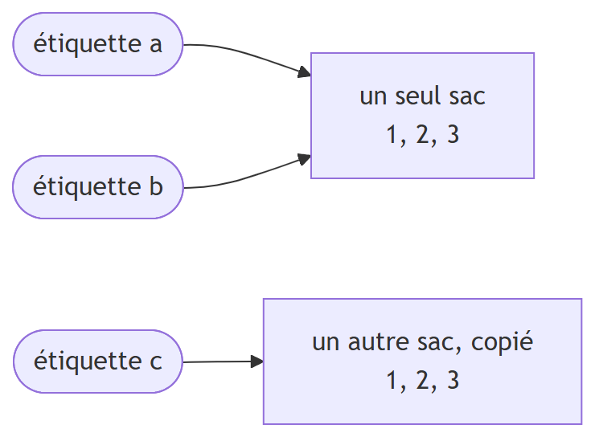

Deux étiquettes, **un seul** sac :

```python
a = [1, 2, 3]
b = a            # même liste !
b.append(4)
print(a)         # [1, 2, 3, 4]
c = a.copy()     # un autre sac
```

Copier : `l.copy()` · `[...l]` · `new ArrayList<>(l)`

---

## Les tableaux associatifs en code

| | Python | JavaScript | Java |
|---|---|---|---|
| Créer | `{"Ada": 36}` | `new Map([["Ada", 36]])` | `new HashMap<>()` |
| Lire | `ages["Ada"]` | `ages.get("Ada")` | `ages.get("Ada")` |
| Ajouter, modifier | `ages["Grace"] = 85` | `ages.set("Grace", 85)` | `ages.put("Grace", 85)` |
| Retirer | `del ages["Alan"]` | `ages.delete("Alan")` | `ages.remove("Alan")` |
| La clé existe ? | `"Alan" in ages` | `ages.has("Alan")` | `ages.containsKey("Alan")` |
| Clé absente | `KeyError` | `undefined` | `null` |

---

# 4. Objets

---

## L'idée : un compte en banque

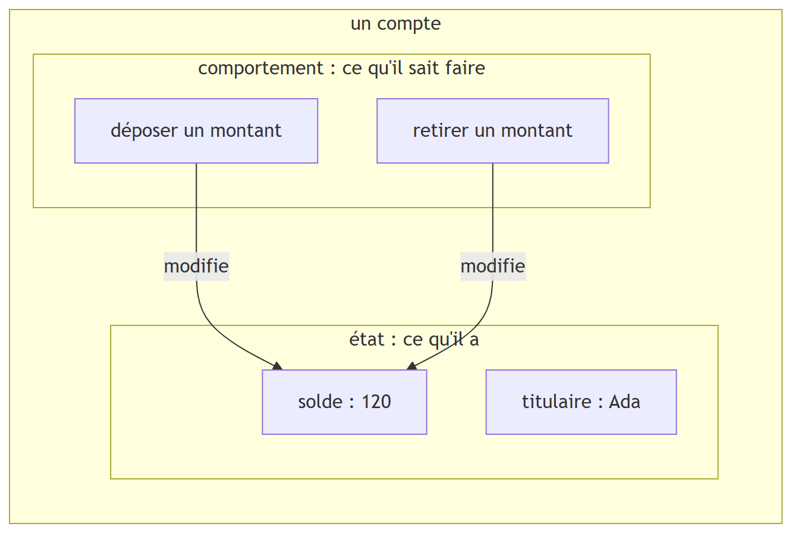

Un **objet** regroupe :

- un **état** : ce qu'il a
- un **comportement** : ce qu'il sait faire

On n'écrit pas soi-même le nouveau solde : on **demande** un dépôt.

Une ligne de tableur, **plus** des actions.

---

## La notation pointée

| En français | En code |
|---|---|
| le solde **du** compte | `compte.solde` |
| compte, **dépose** 30 € | `compte.deposer(30)` |

```javascript
const compte = {
  titulaire: "Ada",
  solde: 120,
  deposer(montant) { this.solde += montant; },
};
compte.deposer(30);
```

Textes et listes sont déjà des objets : `"ada".upper()`, `notes.push(4)`.

---

## Égalité ou identité ?

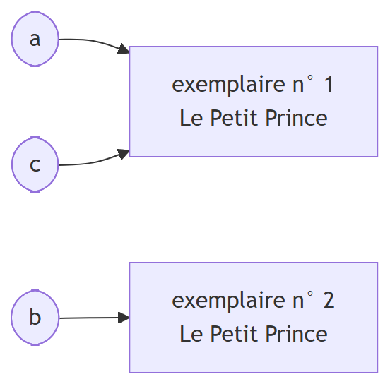

Deux exemplaires du *Petit Prince*, sortis de la même imprimerie :

- même contenu : ils sont **égaux**
- deux objets distincts : ils ne sont pas **identiques**

Si je vous **prête** le mien, nous parlons du même livre : `a` et `c` sont **identiques**.

---

## Égalité et identité en code

| Question | Python | JavaScript | Java |
|---|---|---|---|
| Même contenu ? | `a == b` | à écrire soi-même | `a.equals(b)` |
| Même objet ? | `a is b` | `a === b` | `a == b` |

> **Piège Java** : comparez les textes avec `.equals()`, jamais `==`.

---

## JSON : le relevé de compte

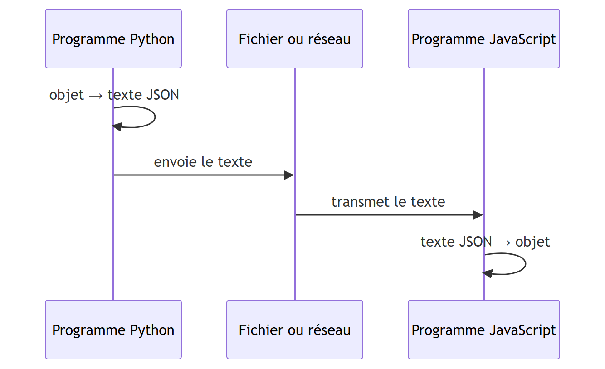

Une photographie de l'**état**, en texte : on ne fait pas de virement avec un relevé.

- Python : `json.dumps(o)`, `json.loads(t)`
- JavaScript : `JSON.stringify(o)`, `JSON.parse(t)`
- Java : une librairie (Jackson…)

Des **données** seulement : pas de méthodes.

---

# 5. Classes

---

## L'idée : la classe des mammifères

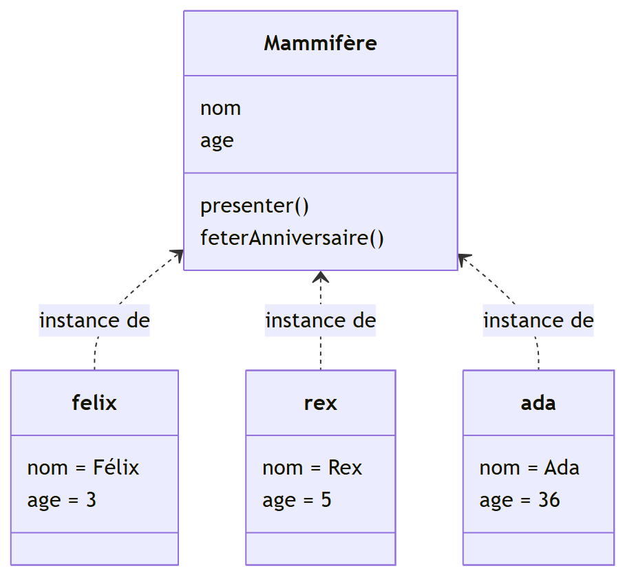

- « Mammifère » est une **description** : elle ne court pas, ne mange pas
- Félix, Rex, Ada sont des **individus** : les **instances**
- Même structure, mêmes capacités ; des valeurs propres à chacun

---

## Dans la nature, en programmation

| Dans la nature | En programmation |
|---|---|
| la description commune des mammifères | la **classe** |
| un individu : Félix | une **instance** |
| son nom, son âge | les **attributs** |
| ce qu'il sait faire | les **méthodes** |
| la naissance, qui donne nom et âge | le **constructeur** |
| « moi-même » : **mon** âge augmente | `self` / `this` |

---

## Le moule et les instances

```python
class Mammifere:
    def __init__(self, nom, age=0):        # le constructeur : la naissance
        self.nom = nom
        self.age = age

    def feter_anniversaire(self):
        self.age += 1                      # self : l'individu concerné

felix = Mammifere("Félix", 3)              # deux instances
rex = Mammifere("Rex", 5)
felix.feter_anniversaire()                 # Félix a 4 ans, Rex toujours 5
```

---

## Les mêmes notions, trois syntaxes

| | Python | JavaScript | Java |
|---|---|---|---|
| Constructeur | `__init__(self, …)` | `constructor(…)` | `Mammifere(…)` |
| L'instance | `self` (explicite) | `this` | `this` |
| Créer | `Mammifere("Félix", 3)` | `new Mammifere("Félix", 3)` | `new Mammifere("Félix", 3)` |
| Privé | `_solde` (convention) | `#solde` | `private` |
| De classe | attribut de classe | `static` | `static` |
| Données seules | `@dataclass` | littéral | `record` |

---

## L'encapsulation : le guichet de la banque

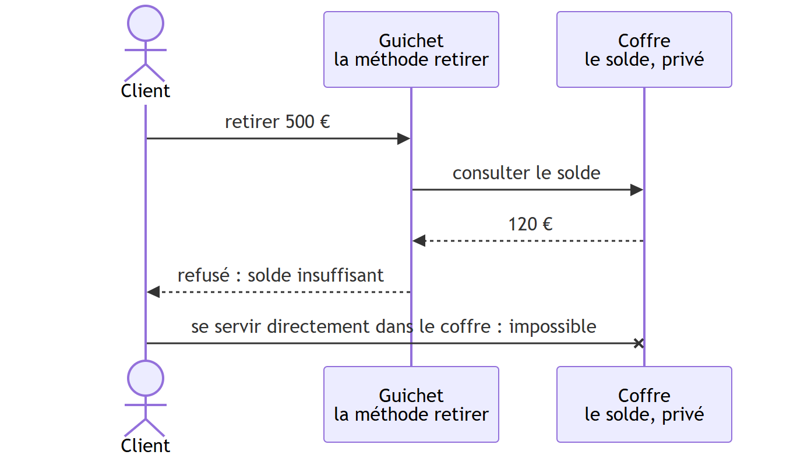

On ne se sert pas dans le coffre : on passe par le **guichet**, qui vérifie les règles.

---

## L'encapsulation en code

```javascript
class Compte {
  #solde = 0;                              // le coffre : privé
  retirer(montant) {                       // le guichet
    if (montant > this.#solde) throw new RangeError("Solde insuffisant");
    this.#solde -= montant;
  }
  get solde() { return this.#solde; }      // consulter, sans modifier
}
```

`compte.solde = -1000` devient impossible : les règles tiennent.

---

## Membres de classe

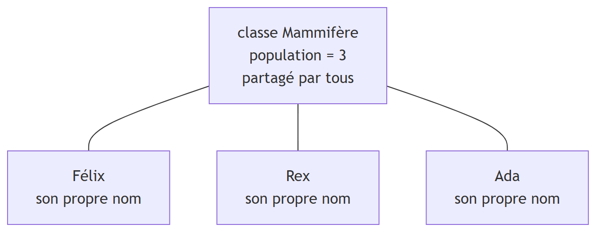

Le nombre de mammifères recensés appartient à la **classe**, pas à un individu.

`static` en JavaScript et en Java ; attribut défini dans la classe en Python.

---

# 6. Héritage

---

## L'idée : chats, chiens et humains sont des mammifères

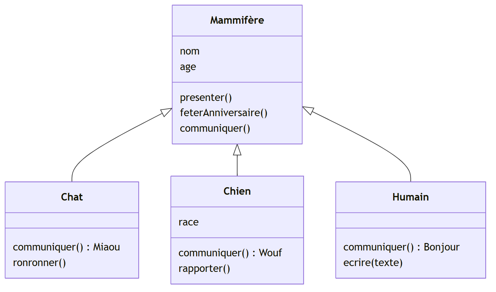

- **Hérité** : nom, âge, se présenter
- **Redéfini** : communiquer, chacun à sa façon
- **Ajouté** : ronronner, rapporter, écrire

Tout chat **est un** mammifère ; l'inverse est faux.

---

## Hériter en code

| | Python | JavaScript | Java |
|---|---|---|---|
| Hériter | `class Chat(Mammifere):` | `extends Mammifere` | `extends Mammifere` |
| Constructeur parent | `super().__init__(nom)` | `super(nom)` | `super(nom)` |
| Méthode parente | `super().communiquer()` | `super.communiquer()` | `super.communiquer()` |
| Redéfinition | — | — | `@Override` |

---

## Le polymorphisme : le recensement

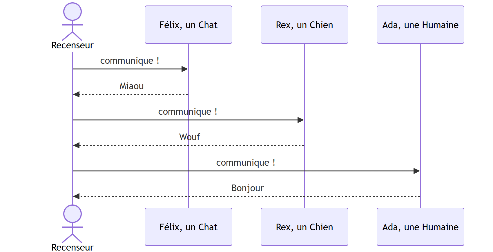

La même question à tous ; chacun répond **à sa façon**.

---

## Le polymorphisme en code

```python
recensement = [Chat("Félix"), Chien("Rex"), Humain("Ada"), Chien("Médor")]
for mammifere in recensement:
    print(mammifere.nom, ":", mammifere.communiquer())
# Félix : Miaou
# Rex : Wouf
# Ada : Bonjour
# Médor : Wouf
```

La boucle ne teste jamais l'espèce. Ajouter une `Vache` ne la change pas.

---

## Un mammifère « tout court » n'existe pas

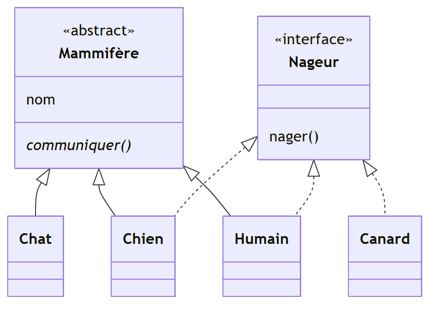

- Classe **abstraite** : aucune instance possible ; elle impose des méthodes à ses enfants
- **Interface** : une capacité, « sait nager », indépendante de la famille
- Le canard nage, sans être un mammifère

---

## Héritage ou composition ?

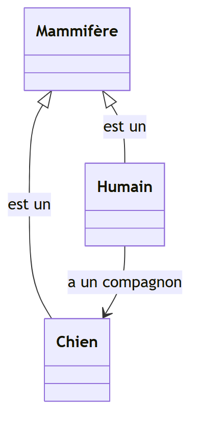

| Relation | Choix | Exemple |
|---|---|---|
| « **est un** » | héritage | un chat est un mammifère |
| « **a un** » | composition (un attribut) | Ada a un chien ; une voiture a un moteur |

> Composition par défaut ; héritage quand la relation « est un » est évidente et stable.

---

# 7. Import et librairies

---

## L'idée : emprunter un livre à la bibliothèque

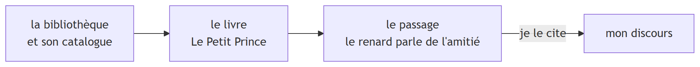

> « On ne voit bien qu'avec le cœur. L'essentiel est invisible pour les yeux. »

On ne réécrit pas le livre : on va chercher **le passage** dont on a besoin, et l'on **cite sa source**.

---

## De la bibliothèque au code

| À la bibliothèque | En programmation |
|---|---|
| le livre *Le Petit Prince* | un **module**, une **librairie** |
| le passage du renard | une **fonction** du module |
| citer le passage | **importer** |
| mes carnets de notes | **mes modules** |
| le dictionnaire, sur le bureau | la **bibliothèque standard** |
| la bibliothèque municipale | le **registre** : PyPI, npm, Maven Central |
| le bibliothécaire | le **gestionnaire de paquets** |
| l'édition du livre | la **version** |

---

## Le livre entier, ou seulement le passage

```python
import le_petit_prince                    # le livre entier
from le_petit_prince import renard        # seulement le passage

print(le_petit_prince.renard())           # je nomme la source
print(renard())                           # je m'en sers directement
```

```text
JavaScript   import { renard } from "./le-petit-prince.mjs";
Java         import fr.diginamic.livres.LePetitPrince;
```

---

## Trois niveaux de code réutilisable

| Niveau | Exemple |
|---|---|
| **Module** : un de vos fichiers | `le_petit_prince.py`, `le-petit-prince.mjs`, `LePetitPrince.java` |
| **Bibliothèque standard** : livrée avec le langage | `math`, `node:fs`, `java.time` |
| **Librairie tierce** : à installer | `requests`, `express`, Jackson |

> « Librairie » est un faux-ami : en français, la librairie **vend**, la bibliothèque **prête**.

---

## Installer : demander au bibliothécaire

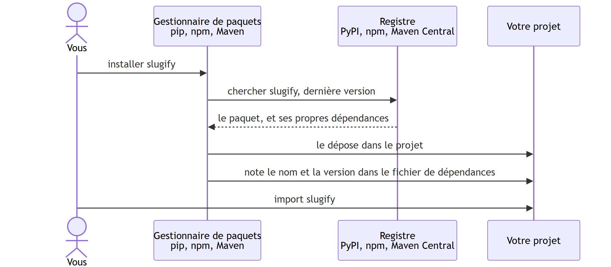

---

## Installer une librairie

| | Python | JavaScript | Java |
|---|---|---|---|
| Registre | PyPI | npm | Maven Central |
| Commande | `pip install nom` | `npm install nom` | dépendance dans `pom.xml` |
| Dépendances | `pyproject.toml` | `package.json` | `pom.xml` |

- Python : toujours dans un **environnement virtuel** (`python -m venv .venv`)
- Versionner le fichier de **verrouillage**, pas `node_modules/` ni `.venv/`

---

## Choisir une librairie

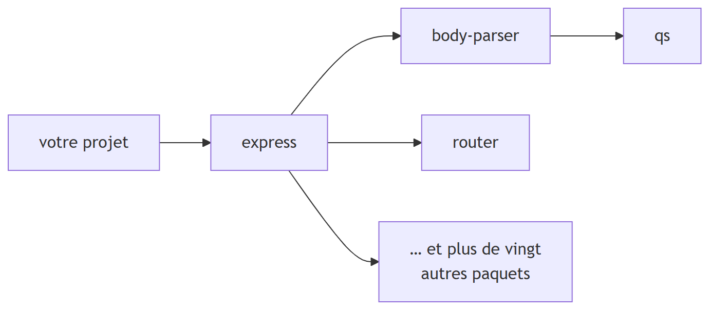

- **Nécessaire ?** d'abord la bibliothèque standard
- **Maintenue ?** versions, tickets
- **Répandue ?** téléchargements
- **Licence** compatible ?
- **Titre exact ?** `reqeusts` ≠ `requests`
- **À jour ?** `npm audit`, `pip-audit`

Un paquet en fait entrer **des dizaines**.

---

## En résumé

| Concept | L'image | L'idée à retenir |
|---|---|---|
| Variable, constante | boîte, sac | un nom pour une valeur ; constant par défaut |
| Type | perles sur un fil | ce qu'est une valeur et ce qu'on peut en faire |
| Liste, dictionnaire | tableur | par position ou par clé ; attention aux références |
| Objet | compte en banque | un état et un comportement |
| Classe | les mammifères | la description ; l'état protégé |
| Héritage | chat, chien, humain | « est un » ; le polymorphisme |
| Import | la bibliothèque | réutiliser plutôt que réécrire, avec discernement |

---

# Des questions ?

### L'aide-mémoire est en annexe du support

Pour toute question [adressez-vous au service pédagogie](mailto:pedagogie@diginamic.fr)
